# MédiPote

Application Android (téléphone) qui aide à prendre ses traitements à l'heure. Un
petit compagnon virtuel compte sur toi : tu lui « donnes » tes médicaments à
chaque prise, il tombe malade si tu oublies, et tes points servent à
l'habiller dans la boutique.

| Accueil | Pilule | Journal | Cycle | Boutique |
|---|---|---|---|---|
| 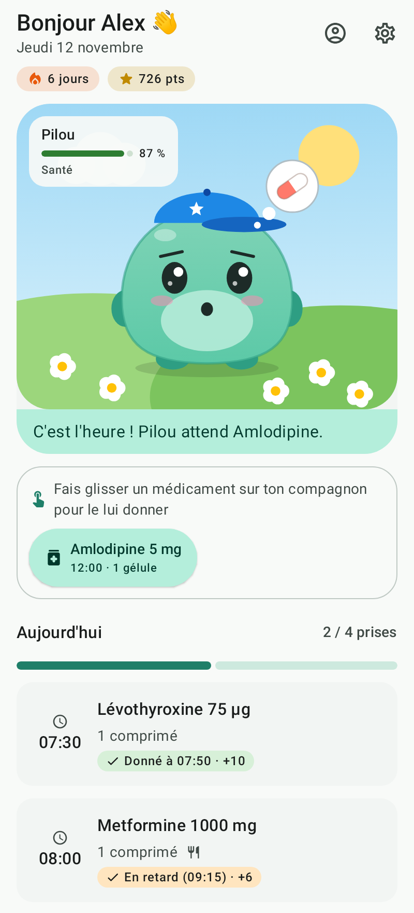 | 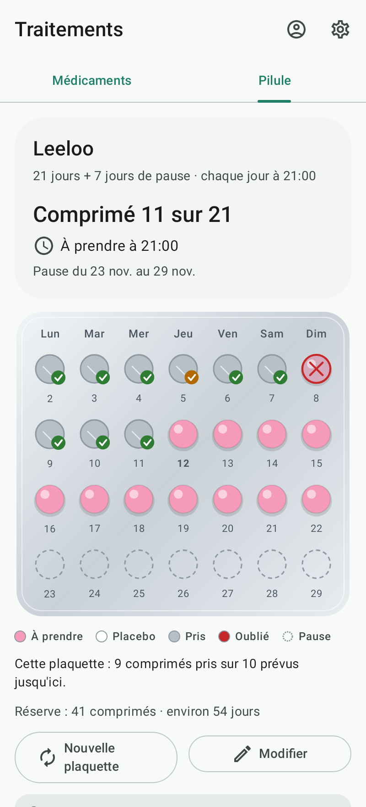 | 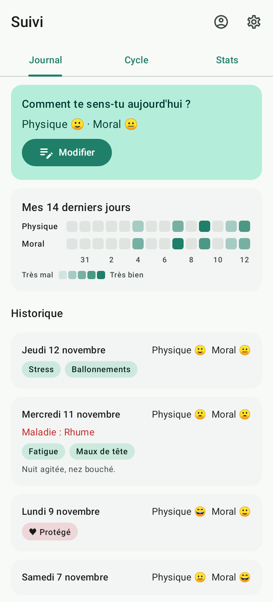 | 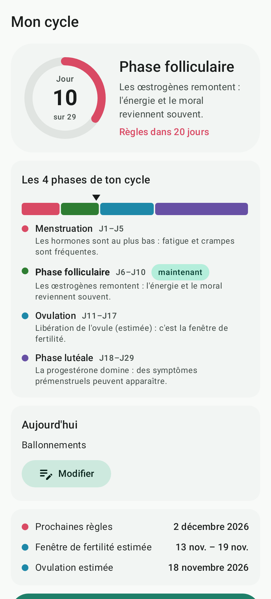 | 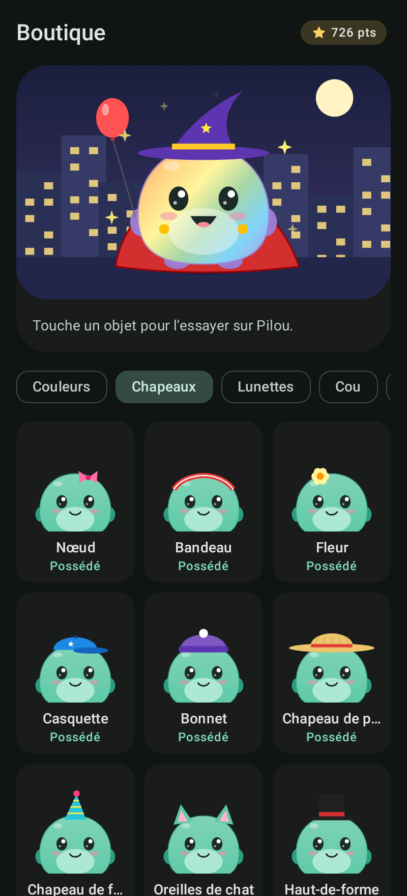 |

| Oubli | Agenda | Statistiques | Saisie du jour | Paramètres |
|---|---|---|---|---|
| 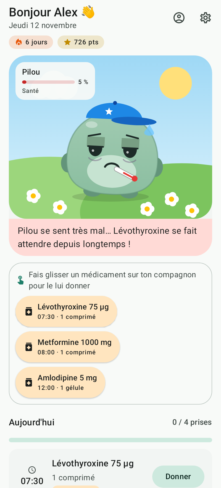 | 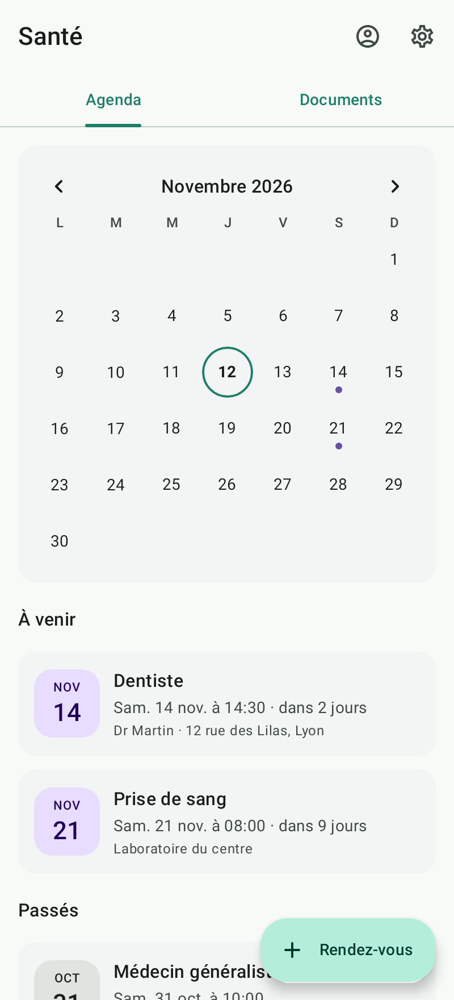 | 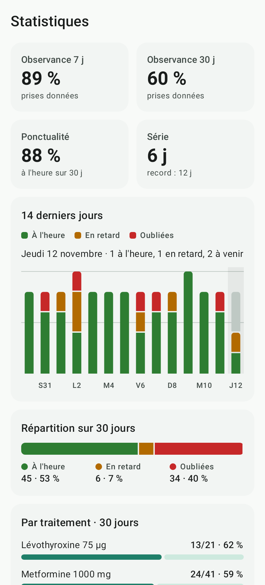 | 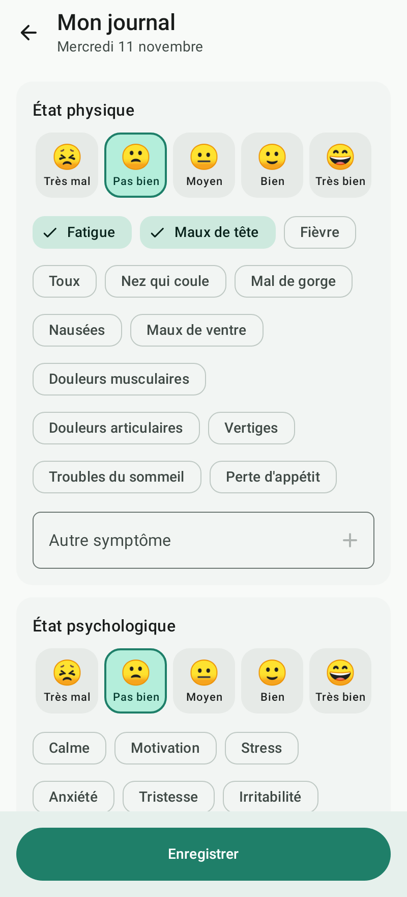 | 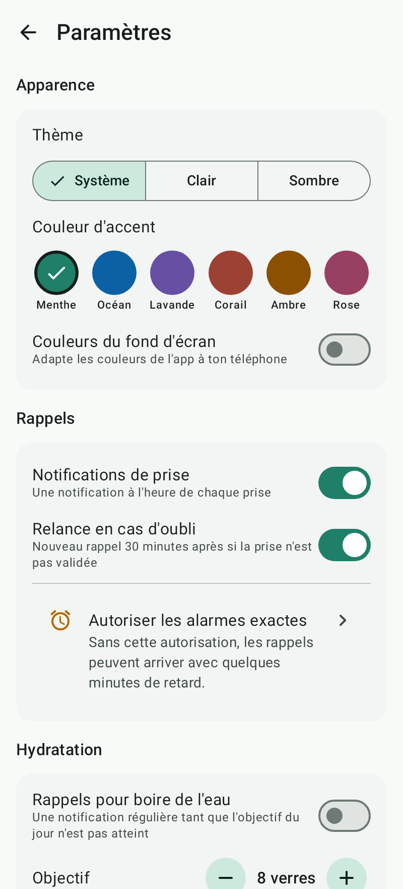 |

| Si besoin (accueil) | Noter une prise | Stats « si besoin » | Sommeil | Noter sa nuit |
|---|---|---|---|---|
|  | 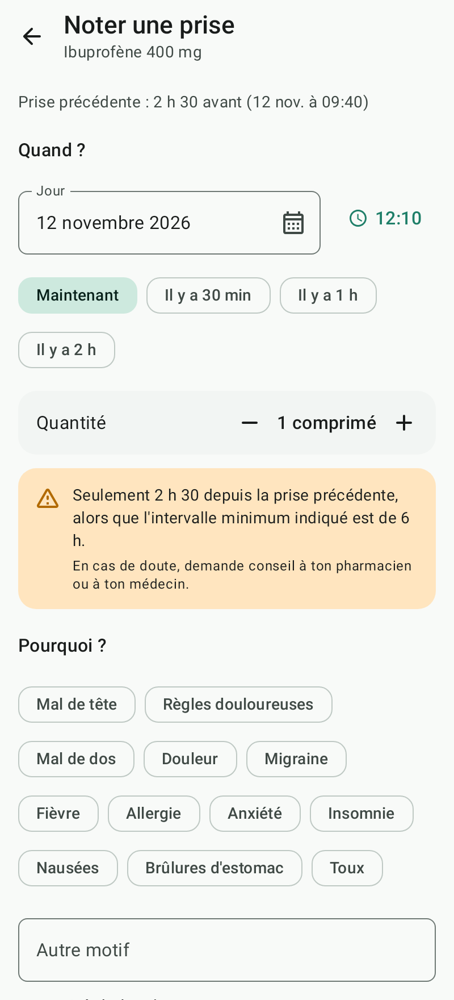 | 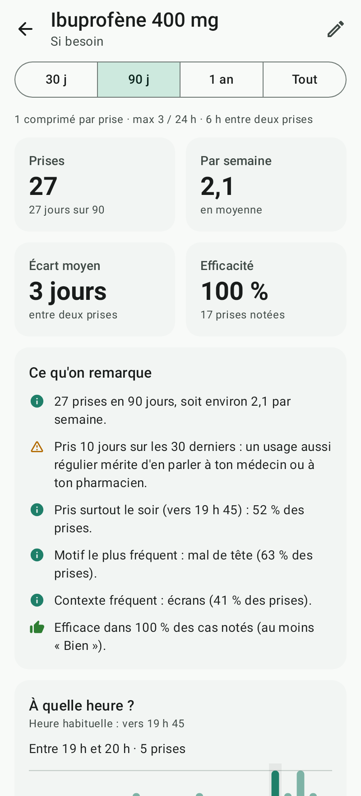 | 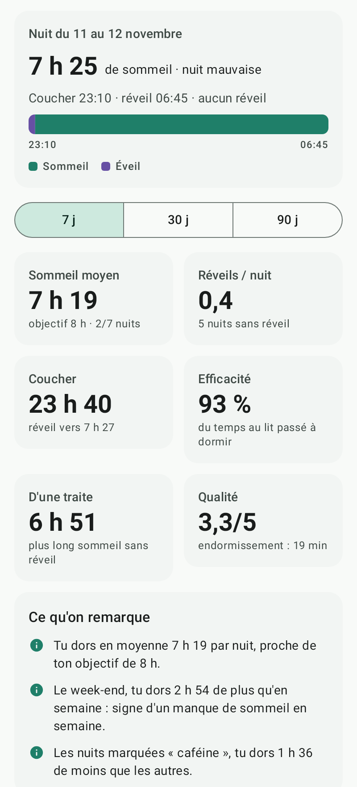 | 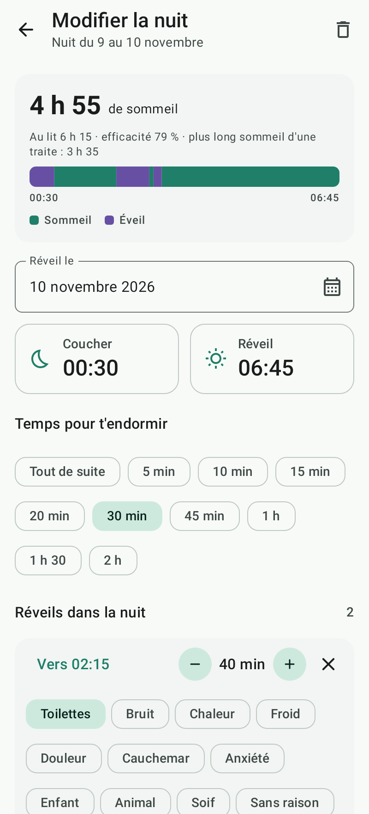 |

## Navigation

| Onglet | Contenu |
|---|---|
| **Accueil** | Compagnon, prises du jour, hydratation, journal du jour, prochain rendez-vous, alerte de stock |
| **Traitements** | *Médicaments* (liste, stock, rachat) · *Pilule* (plaquette, semaine de pause) |
| **Suivi** | *Journal* · *Sommeil* · *Cycle* (si activé dans le profil) · *Stats* |
| **Santé** | *Agenda* des rendez-vous · *Documents* (carnet de santé) |
| **Boutique** | Accessoires du compagnon |

Profil médical et paramètres sont accessibles en haut à droite.

## Fonctionnalités

- **Profil médical** : prénom, âge, poids, taille (IMC calculé), sexe,
  antécédents et allergies (suggestions + saisie libre), suivi du cycle.
- **Guide des médicaments intégré** : environ 130 médicaments courants en France,
  recherche sans accents par nom commercial, molécule (DCI) ou classe, fiche
  courte (indication, posologie habituelle, précautions, ordonnance) et alerte
  si une allergie déclarée peut être concernée. Saisie manuelle possible.
- **Posologie** : 1 à 4 prises par jour ou horaires libres, quantité, forme,
  jours de la semaine, date de fin ou traitement au long cours, prise au repas. Changer l'heure d'une prise déjà donnée ne
  la fait pas redonner : elle suit sa nouvelle heure (aujourd'hui comme dans
  l'historique), et une heure ajoutée n'est due qu'à partir de son ajout.
- **Médicaments « si besoin »** (antidouleur, antiallergique, anxiolytique…) :
  dans l'éditeur, type de prise « Si besoin » au lieu de « À heures fixes ».
  Pas d'horaire, pas de rappel, pas de points (pour ne jamais encourager à en
  prendre plus). Chaque prise se note en deux touches depuis l'accueil ou
  l'onglet Traitements : heure (maintenant, il y a 30 min…), quantité, motif
  (mal de tête, règles douloureuses… ou texte libre), intensité de la gêne
  (0–10), contexte (travail, stress, écrans, fatigue, règles… ou texte libre),
  notes. Limites facultatives (maximum par 24 h, délai minimum entre deux
  prises) : un avertissement s'affiche si une prise les dépasse, sans bloquer.
  Une notification une heure après demande si ça a fait effet (5 niveaux).
  Le stock baisse à chaque prise, avec un seuil d'alerte en unités.
- **Stock** : quantité restante et taille de boîte par traitement. Le stock
  baisse à chaque prise ; MédiPote estime les jours restants, prévient quand
  il en reste moins que le seuil choisi (7 jours par défaut), puis rappelle
  chaque matin à 10 h jusqu'au rachat. Bouton « + boîte » sur la fiche.
- **Pilule** : choix de la pilule et du rythme (21 + 7 jours de pause, 24 + 4,
  21 + 7 placebos, 24 + 4 placebos, 28 en continu), plaquette dessinée jour par
  jour (pris, en retard, oublié, à venir, placebo, pause), dates de la semaine
  de pause et de la prochaine plaquette, rappel quotidien (aucun pendant la
  pause), réserve de plaquettes.
- **Compagnon** : il réclame son médicament, s'affaiblit en cas de retard,
  tombe malade au-delà de 2 h et dort la nuit. On le soigne en faisant glisser
  la pilule sur lui, ou avec « Donner ». Une prise déjà faite plus tôt dans la
  journée se note avec « Déjà pris ? » (après confirmation) : son rappel ne sonne pas.
- **Jouer avec le compagnon** (accueil et boutique) :
  - le toucher : il saute et dit quelque chose d'utile (prise à donner, prochaine
    prise, verre d'eau, rendez-vous proche, journal, objet à s'offrir…) ;
  - plusieurs touches rapides : fou rire ; trop de touches : il a le tournis ;
  - le caresser en glissant le doigt de côté : il ronronne, des cœurs apparaissent ;
  - appui long : gros câlin ;
  - malade, il éternue ; la nuit, on le réveille et il bâille ;
  - ses yeux suivent le doigt, il dit bonjour à l'ouverture de l'app, et le
    premier câlin du jour rapporte +3 points.

  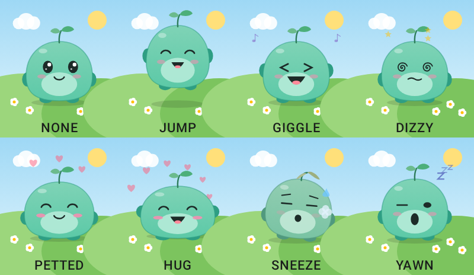

  Retour haptique à chaque réaction ; avec TalkBack, « Caresser » et « Faire un
  câlin » sont proposés comme actions.
- **Hydratation** : compteur de verres sur l'accueil (et en widget), objectif
  réglable, +2 points par verre et +10 à l'objectif, rappels toutes les 1 à 3 h
  dans une plage horaire tant que l'objectif n'est pas atteint.
- **Sommeil** (Suivi › Sommeil) : chaque matin, heure du coucher, temps
  d'endormissement, heure du réveil et **réveils dans la nuit** (heure, durée,
  cause : toilettes, bruit, chaleur, douleur, cauchemar, anxiété, enfant…),
  qualité de la nuit (5 niveaux), ce qui a pu jouer (écrans, caféine, alcool,
  sport, repas tardif, stress…) et notes. La saisie est pré-remplie avec tes
  horaires habituels et affiche la nuit en direct sur une frise (sommeil /
  éveil) avec durée de sommeil, temps au lit, efficacité et plus long sommeil
  d'une traite. Statistiques sur 7, 30 ou 90 jours : sommeil moyen et nuits à
  l'objectif, réveils par nuit et nuits sans réveil, heures habituelles de
  coucher et de réveil, efficacité, endormissement, qualité ; durée par nuit
  (ou par semaine sur 90 jours) avec l'objectif en pointillés, réveils par heure
  et leurs causes, historique avec frise de chaque nuit. Analyses : écart à
  l'objectif, tendance, heure des réveils, cause principale, régularité du
  coucher, efficacité, rattrapage du week-end, effet d'une habitude (« les nuits
  avec caféine, tu dors 1 h 30 de moins ») et lien avec la forme notée dans le
  journal. Objectif (8 h par défaut) et rappel du matin (désactivé par défaut)
  dans les paramètres ; +3 points pour la nuit notée le matin même (jamais liés
  à la durée ni à la qualité du sommeil).
- **Journal** : chaque jour, état physique et psychologique (5 niveaux),
  symptômes, maladie du jour, notes ; carte des 14 derniers jours.
- **Cycle** : les 4 phases (menstruation, folliculaire, ovulation, lutéale) sur
  une frise avec le jour actuel, prochaines règles, fenêtre de fertilité,
  calendrier où l'on touche un jour pour noter flux, symptômes physiques ou
  émotionnels et rapports sexuels (protégés ou non). Noter un flux démarre un
  nouveau cycle si besoin.
- **Agenda** : rendez-vous médicaux (motif, praticien, lieu, notes) dans un
  calendrier mensuel, avec rappels au choix (1 semaine, la veille, 2 h, 1 h,
  30 min avant).
- **Carnet de santé** : photos d'ordonnances, d'analyses ou de comptes-rendus
  prises avec l'appareil photo, ou fichiers PDF/images importés ; classement
  par catégorie, date et notes ; visionneuse avec zoom (toutes les pages d'un
  PDF) et partage.
- **Points**

  | Action | Points |
  |---|---|
  | Prise à l'heure (de 1 h avant à 30 min après) | +10 |
  | En retard (jusqu'à 2 h) | +6 (malus −4) |
  | Très en retard (au-delà de 2 h) | +3 (malus −7) |
  | Noté « Déjà pris ? » plus d'1 h avant l'horaire (le jour même) | +6 |
  | Journée parfaite (toutes les prises à l'heure) | +20 |
  | Journal du jour rempli | +5 |
  | Verre d'eau (jusqu'à l'objectif du jour) | +2 par verre |
  | Objectif d'hydratation atteint | +10 |
  | Premier câlin du jour | +3 |
  | Nuit notée le matin même | +3 |
  | Connexion quotidienne | +5 × jours de série, plafonné à +50 (dès le 10e jour) |
  | Paliers de série | 7 j : +30 · 30 j : +100 · 100 j : +300 · 365 j : +1000 |

- **Boutique** : 59 objets en 7 catégories (couleurs, chapeaux, lunettes, cou,
  objets, effets animés, décors), essayage avant achat, tous dessinés en Canvas.
- **Statistiques** (période 7, 30 ou 90 jours) : observance comparée à la
  période précédente, ponctualité, écart moyen avec l'heure prévue, série ;
  phrases d'analyse (moment ou jour le plus souvent oublié, traitement le plus
  oublié, tendance, forme les jours où tout est pris…) ; 14 derniers jours,
  évolution sur 12 semaines, calendrier de 12 semaines, répartition, observance
  par moment de la journée, par jour de la semaine et par traitement ;
  hydratation et bien-être moyens ; historique des points.
- **Statistiques « si besoin »** (30 j, 90 j, 1 an ou tout) : nombre de prises,
  jours concernés, prises par semaine, écart moyen entre deux prises,
  efficacité ressentie ; heure habituelle (moyenne circulaire : 23 h 30 et
  0 h 30 donnent minuit), histogramme par heure et par moment, par jour de la
  semaine, motifs et contextes classés, intensité moyenne, part des prises
  pendant les règles, 12 dernières semaines, historique modifiable. Une alerte
  conseille d'en parler à un professionnel au-delà de 10 jours d'usage sur 30
  ou si le maximum quotidien a été dépassé.
- **Apparence** : thème clair, sombre ou système, 6 couleurs d'accent
  (Menthe, Océan, Lavande, Corail, Ambre, Rose) ou couleurs du fond d'écran
  (Android 12+).

- **Widgets d'écran d'accueil** (appui long sur l'écran d'accueil → Widgets → MédiPote) :

  | Widget | Contenu | Tailles |
  |---|---|---|
  | Mon compagnon | Le compagnon avec son humeur, sa santé, la prochaine prise et un bouton « Donner » | 2×2 à 4×3 |
  | Prises du jour | Les prises du jour avec leur état, et « Donner » pour celles à prendre | 3×2 et plus |
  | Hydratation | Verres du jour, progression, boutons « +1 verre » et « − » | 2×2 et plus |

  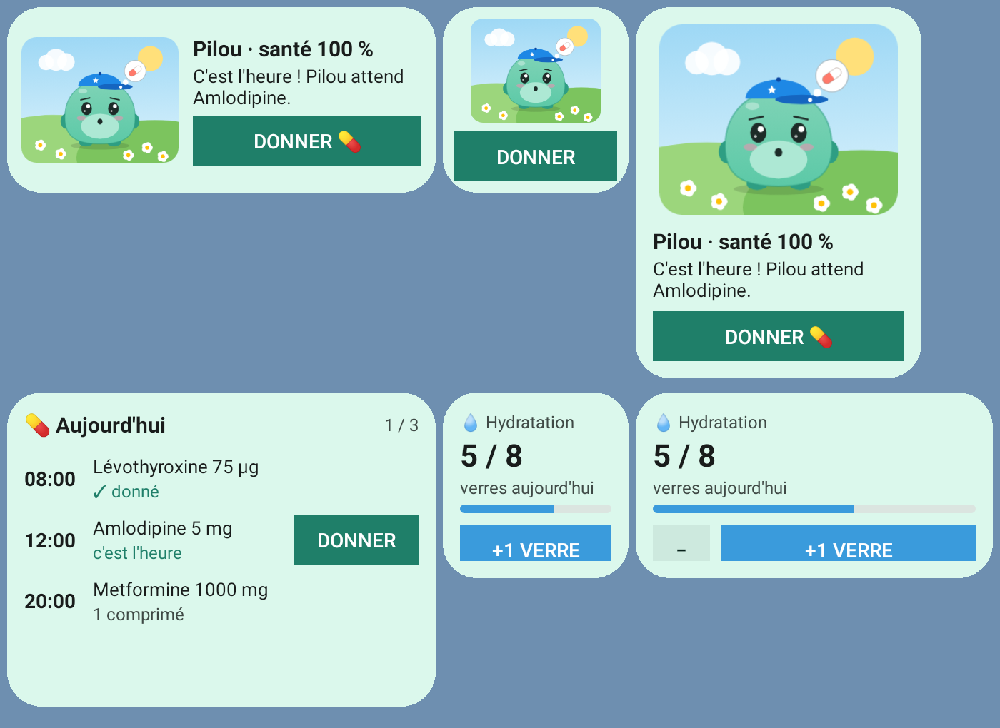

Les données (y compris de santé et les documents) restent sur le téléphone, dans
le stockage privé de l'app, exclu de la sauvegarde cloud.

## Architecture

| Dossier | Contenu |
|---|---|
| `data/` | Modèles sérialisables (`Models.kt`, `Health.kt`), stockage JSON atomique (`AppRepository`), fichiers du carnet de santé (`DocumentStore`), guide des médicaments (`DrugGuide`) |
| `domain/` | Règles pures et testées : planning des prises (`Schedule`), points, série et santé du compagnon (`Game`), boutique, statistiques et analyses (`Stats`, `Reports`), prises « si besoin » (`Prn`), cycle |
| `notifications/` | `ReminderPlanner` (calcul pur et testé des alarmes : prises, relances, rendez-vous, eau, stock), `ReminderScheduler` (AlarmManager) et récepteurs |
| `widget/` | Widgets Jetpack Glance (compagnon, prises du jour, hydratation) et leurs actions |
| `ui/` | Jetpack Compose + Material 3 : un écran par dossier, `PetView` (compagnon dessiné en Canvas), navigation dans `MediPoteApp` |

Une prise prévue avant l'ajout du traitement n'est pas due : ajouter à 15 h un
médicament prévu à 8 h ne rend pas le compagnon malade.

## Notifications

Les rappels utilisent des alarmes exactes (`USE_EXACT_ALARM` sur Android 13+,
accordée automatiquement). Si un téléphone les refuse quand même, l'app se
replie sur une fenêtre de 10 minutes au plus. Dans **Paramètres → Rappels** :

- **Tester les notifications** envoie une notification tout de suite, puis une
  autre une minute plus tard par le même chemin que les vrais rappels ;
- un avertissement apparaît (ici et sur l'accueil) si les notifications sont
  bloquées, avec un raccourci vers les réglages du téléphone ;
- un raccourci vers l'**optimisation de la batterie** est proposé : sur
  certains téléphones (Xiaomi, Huawei, Samsung…), choisir « Non restreinte »
  pour MédiPote évite que les rappels soient retardés ou supprimés.

> `USE_EXACT_ALARM` est réservée sur le Play Store aux applications de type
> réveil ou calendrier. Pour une publication, il faudra peut-être la remplacer
> par `SCHEDULE_EXACT_ALARM` (que l'utilisateur accorde lui-même).

## Compiler et tester

JDK 17+ et le SDK Android (plateforme 37).

```bash
./gradlew :medipote:assembleDebug       # medipote/build/outputs/apk/debug/medipote-debug.apk
./gradlew :medipote:testDebugUnitTest   # 75 tests : règles métier, alarmes et notifications, widgets, écrans (captures dans medipote/build/screenshots) et parcours complet
adb install -r medipote/build/outputs/apk/debug/medipote-debug.apk
./gradlew :medipote:assembleRelease     # APK release signé (voir RELEASE.md)
```

Minimum : Android 8.0 (API 26). La version debug s'installe à côté de la release,
sous le nom « MédiPote (debug) ».

Release signée, AAB pour le Play Store, optimisations et checklist de publication :
voir [RELEASE.md](RELEASE.md). Politique de confidentialité : [PRIVACY.md](PRIVACY.md).

## Avertissement

MédiPote est un aide-mémoire : il ne remplace pas l'avis d'un médecin ou d'un
pharmacien. Les fiches du guide sont volontairement courtes et indicatives ; la
référence officielle est la
[base de données publique des médicaments](https://base-donnees-publique.medicaments.gouv.fr).
Le suivi du cycle repose sur la méthode du calendrier et n'est pas une méthode
de contraception.
