# MédiPote

Application Android (téléphone) qui aide à prendre ses traitements à l'heure. Un
petit compagnon virtuel compte sur toi : tu lui « donnes » tes médicaments à
chaque prise, il tombe malade si tu oublies, et tes points servent à
l'habiller dans la boutique.

| Accueil | Pilule | Journal | Cycle | Boutique |
|---|---|---|---|---|
|  | 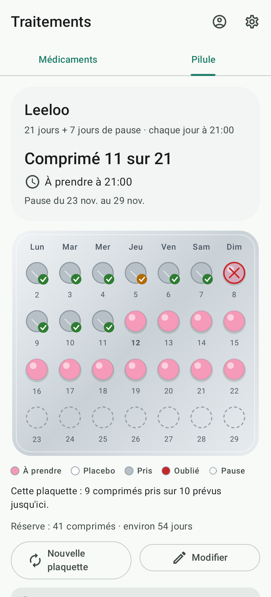 | 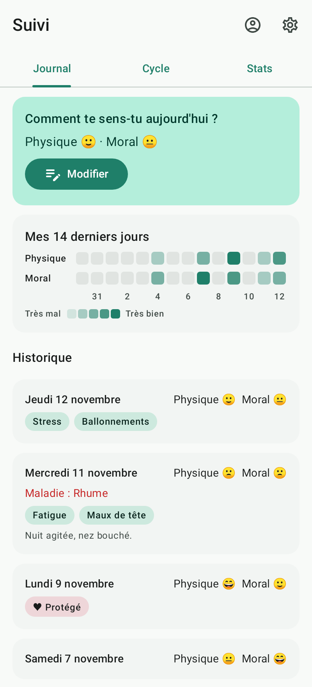 |  | 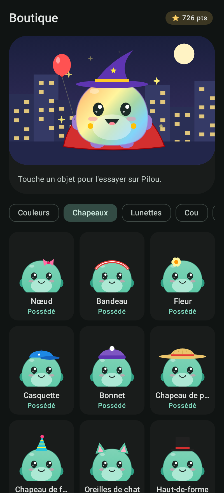 |

| Oubli | Agenda | Statistiques | Saisie du jour | Paramètres |
|---|---|---|---|---|
| 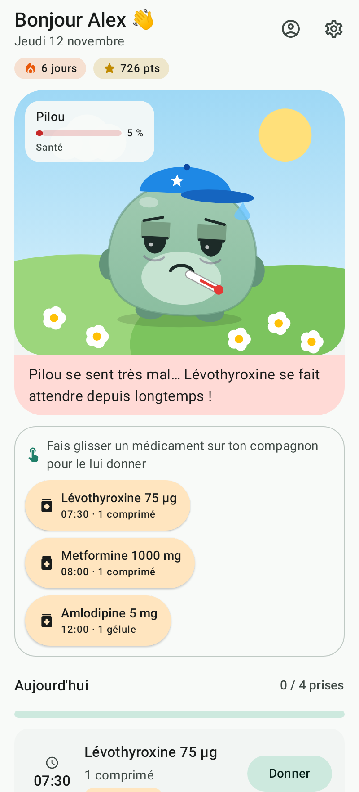 |  |  | 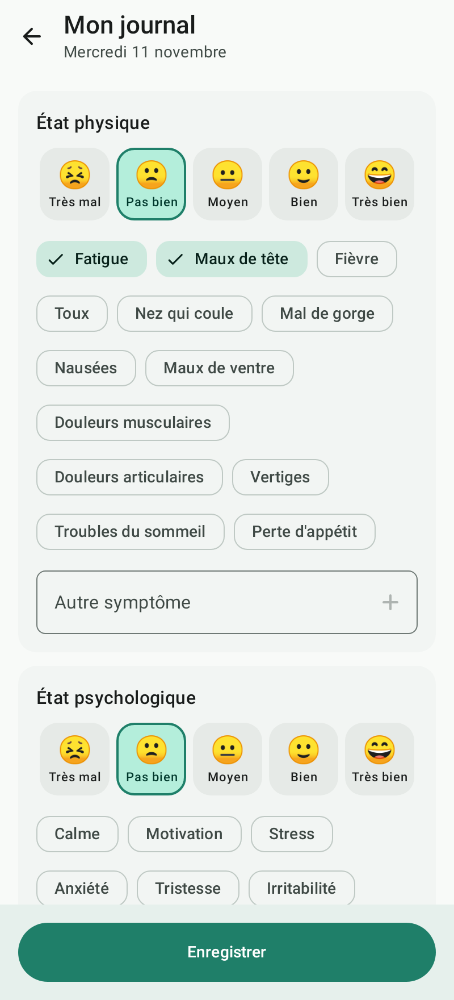 | 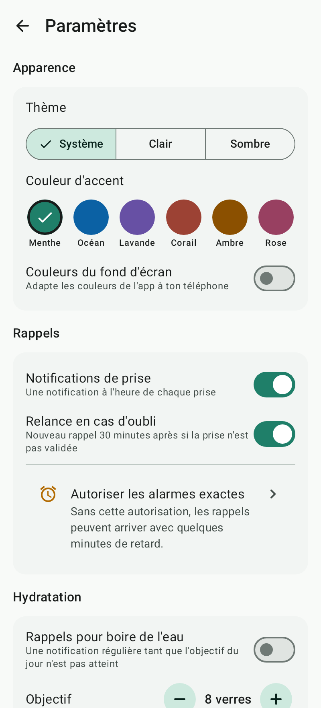 |

| Accueil | Mesures | Sauvegarde | Si besoin (accueil) | Noter une prise |
|---|---|---|---|---|
|  | 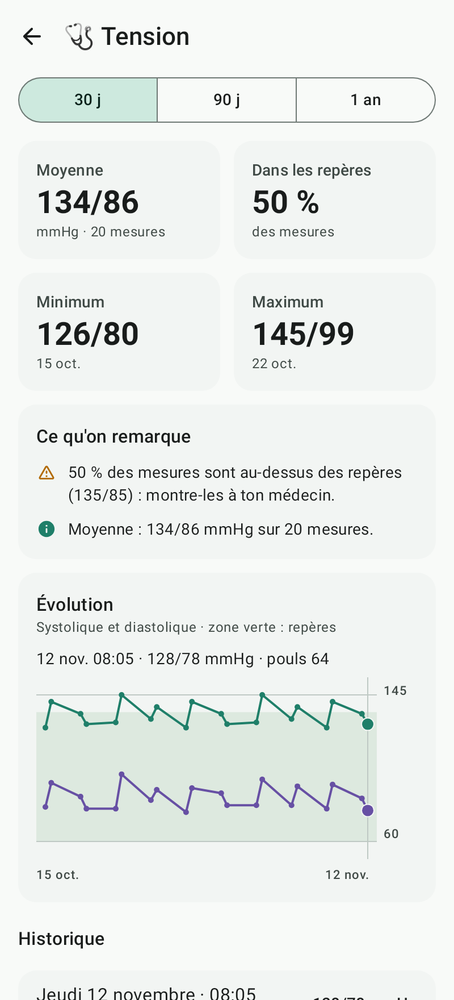 |  | 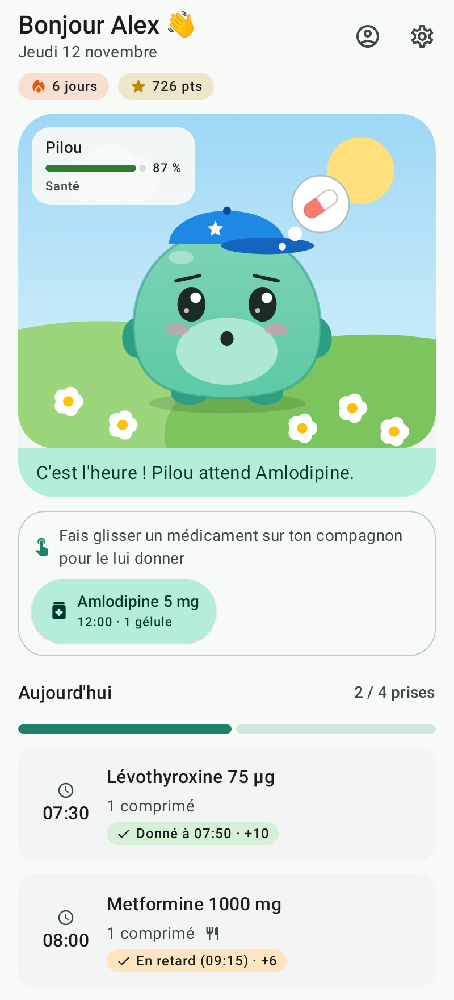 |  |

| Stats « si besoin » | Sommeil | Noter sa nuit | Rapport PDF |
|---|---|---|---|
| 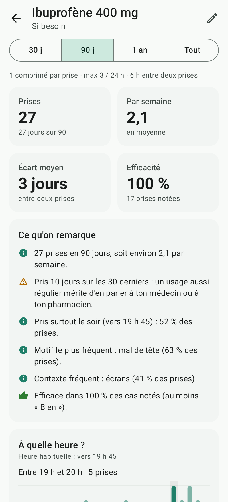 | 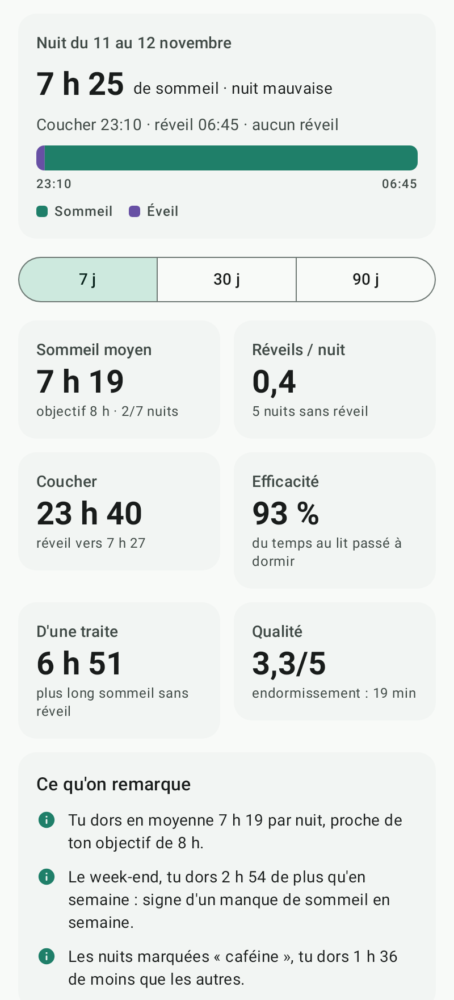 |  |  |

| Accueil personnalisé | Noir pur | Personnaliser | Série du jour | Prises oubliées |
|---|---|---|---|---|
| 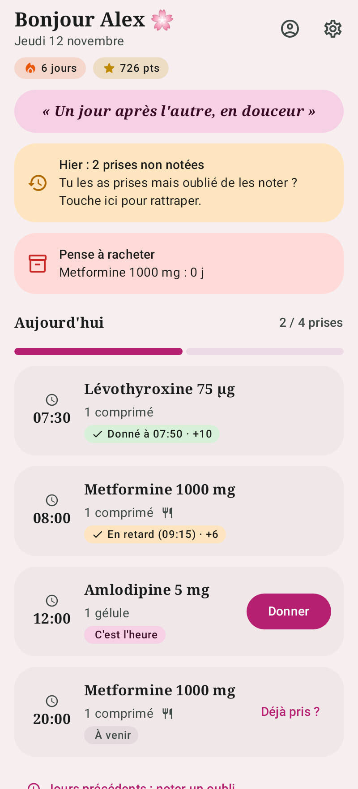 |  | 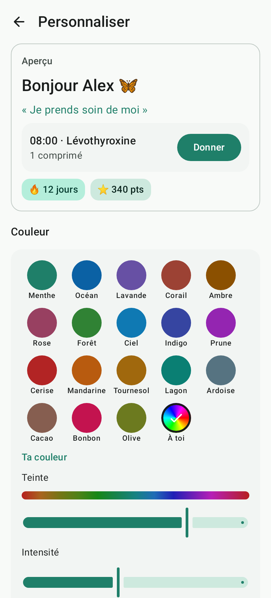 | 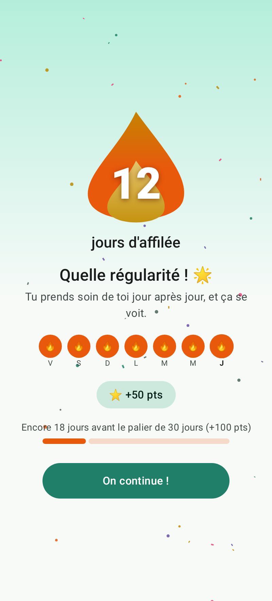 |  |

| Accueil 1.5 | Badges et défis | Rituel du matin | Ma journée | Année en pixels |
|---|---|---|---|---|
| 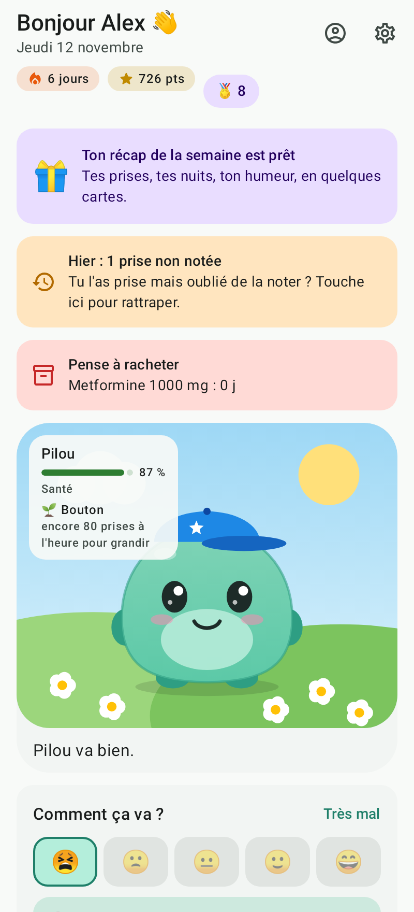 | 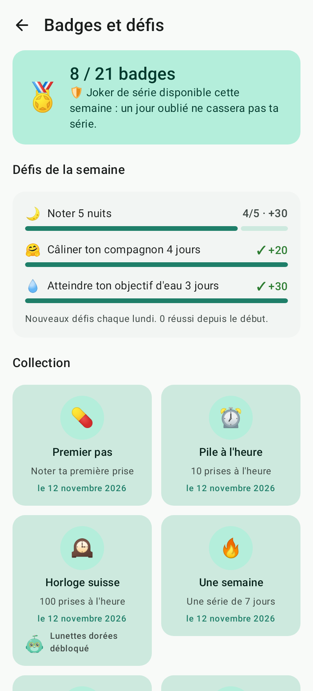 |  |  | 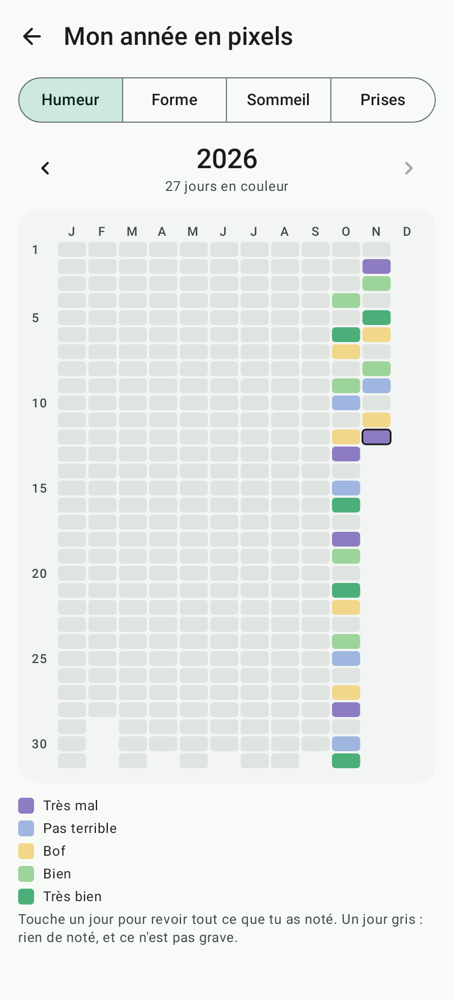 |

Objets exclusifs gagnés avec les badges :


Le compagnon grandit avec la régularité (graine, pousse, bouton, fleur, floraison) :


## Navigation

Cinq espaces en bas de l'écran. Chacun s'ouvre sur une **page de cartes** bien aérées, avec une
ligne en direct sous chaque nom (« Cette nuit : 7 h 30 », « Dentiste · dans 2 jours »…) ; une carte
s'ouvre avec une flèche pour revenir à la page.

| Espace | Cartes |
|---|---|
| **Accueil** | Prochaine prise en grand, compagnon, humeur, rituel, protection, prises du jour, si besoin, mesures, eau, rendez-vous : chaque bloc seulement quand il sert, ordre et affichage au choix (Paramètres › Mon accueil). Bouton « + Noter » pour tout noter en deux gestes. |
| **Soins** | 💊 Traitements · 🔁 Pilule (si concernée) · 📅 Agenda · 📂 Carnet de santé |
| **Suivi** | 📖 Journal · 🌙 Sommeil · 🩺 Mesures (si activées) · 🩸 Cycle (si activé) · 🌡️ Symptômes (si activés) |
| **Mieux-être** | 💛 Journée douce (si activée) · 🤗 Ça ne va pas · 🌬️ Respirer · ✨ Rituels · 🌿 Ce qui m'accompagne |
| **Moi** | 📊 Statistiques (sous-onglets, voir plus bas) · 📋 Jour par jour · 📆 Mon année · 🛍️ Boutique · 🏅 Badges et défis |

Chacun choisit ses cartes : **Paramètres › Mes cartes** (ou « ✏️ Choisir mes cartes » en bas de chaque
page) masque celles qu'on n'utilise pas. Rien n'est supprimé : une carte masquée revient avec son
interrupteur.

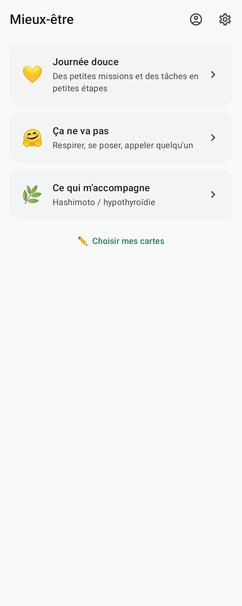

Les écrans restent aérés : cartes de traitements et jours du journal compacts
(le détail s'ouvre au toucher), sommeil avec l'essentiel d'abord (« Plus de
détails », « Voir mes nuits précédentes »), cartes protection et médicaments en
haut du cycle pendant les règles, badges gagnés d'abord et les autres repliés.

Profil médical et paramètres sont accessibles en haut à droite.

| Accueil 1.8 | Bouton « + Noter » |
|---|---|
| 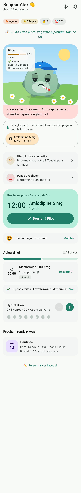 | 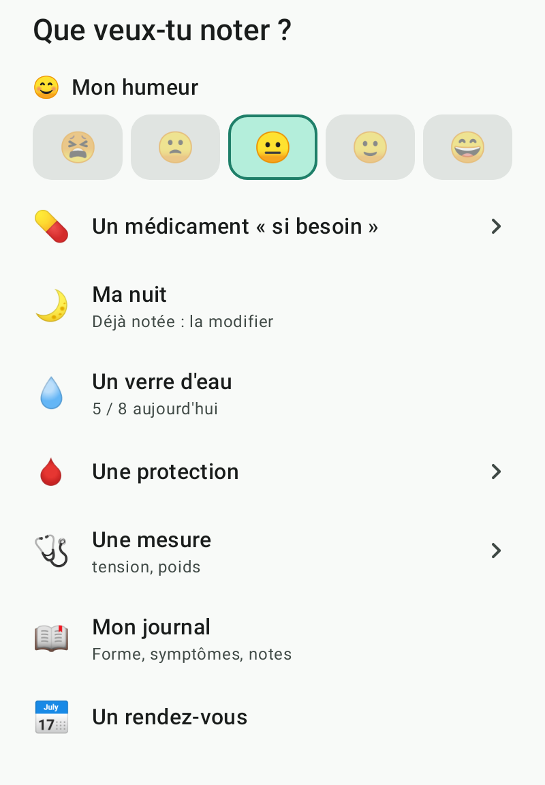 |

Chaque jour, une petite phrase douce s'affiche en haut de l'accueil, et le fond du
compagnon suit l'heure (aube, jour, coucher de soleil, nuit).


Pour garder l'appli aérée : les explications sont repliées derrière « ⓘ À savoir »
ou un petit ⓘ, et les formulaires (traitement, nuit, journal, rendez-vous, mesure)
montrent l'essentiel, le reste sous « Plus d'options ».

## Fonctionnalités

- **Profil médical** : prénom, âge, poids, taille (sans calcul d'IMC), sexe,
  antécédents et allergies (suggestions + saisie libre), suivi du cycle.
- **Guide des médicaments intégré** : environ 130 médicaments courants en France,
  recherche sans accents par nom commercial, molécule (DCI) ou classe, fiche
  courte (indication, posologie habituelle, précautions, ordonnance) et alerte
  si une allergie déclarée peut être concernée. Saisie manuelle possible.
- **Posologie** : 1 à 4 prises par jour ou horaires libres, quantité, forme,
  tous les jours, certains jours de la semaine ou **tous les N jours** ;
  au long cours, jusqu'à une date ou **pendant N jours** ; prise au repas ;
  **paliers** (dose qui change à des dates données, par exemple une
  corticothérapie dégressive : la quantité du jour est utilisée partout,
  stock compris). Changer l'heure d'une prise déjà donnée ne
  la fait pas redonner : elle suit sa nouvelle heure (aujourd'hui comme dans
  l'historique), et une heure ajoutée n'est due qu'à partir de son ajout.
- **Médicaments « si besoin »** (antidouleur, antiallergique, anxiolytique…) :
  dans l'éditeur, type de prise « Si besoin » au lieu de « À heures fixes ».
  Pas d'horaire, pas de rappel, pas de points (pour ne jamais encourager à en
  prendre plus). Chaque prise se note en deux touches depuis l'accueil ou
  l'onglet Traitements : heure (maintenant, il y a 30 min…), quantité, motif
  (mal de tête, règles douloureuses… ou texte libre), intensité de la gêne
  (0–10), contexte (travail, stress, écrans, fatigue, règles… ou texte libre),
  notes. Limites facultatives (maximum par 24 h, délai minimum entre deux
  prises) : un avertissement s'affiche si une prise les dépasse, sans bloquer.
  Une notification une heure après demande si ça a fait effet (5 niveaux).
  Le stock baisse à chaque prise, avec un seuil d'alerte en unités.
- **Stock** : quantité restante et taille de boîte par traitement. Le stock
  baisse à chaque prise ; MédiPote estime les jours restants, prévient quand
  il en reste moins que le seuil choisi (7 jours par défaut), puis rappelle
  chaque matin à 10 h jusqu'au rachat. Bouton « + boîte » sur la fiche.
- **Pilule** : choix de la pilule et du rythme (21 + 7 jours de pause, 24 + 4,
  21 + 7 placebos, 24 + 4 placebos, 28 en continu), plaquette dessinée jour par
  jour (pris, en retard, oublié, à venir, placebo, pause), dates de la semaine
  de pause et de la prochaine plaquette, rappel quotidien (aucun pendant la
  pause), réserve de plaquettes.
- **Compagnon** : il réclame son médicament, s'affaiblit en cas de retard,
  tombe malade au-delà de 2 h et dort la nuit. On le soigne en faisant glisser
  la pilule sur lui, ou avec « Donner ». Une prise déjà faite plus tôt dans la
  journée se note avec « Déjà pris ? » (après confirmation) : son rappel ne sonne pas.
- **Jouer avec le compagnon** (accueil et boutique) :
  - le toucher : il saute et dit quelque chose d'utile (prise à donner, prochaine
    prise, verre d'eau, rendez-vous proche, journal, objet à s'offrir…) ;
  - plusieurs touches rapides : fou rire ; trop de touches : il a le tournis ;
  - le caresser en glissant le doigt de côté : il ronronne, des cœurs apparaissent ;
  - appui long : gros câlin ;
  - malade, il éternue ; la nuit, on le réveille et il bâille ;
  - ses yeux suivent le doigt, il dit bonjour à l'ouverture de l'app, et le
    premier câlin du jour rapporte +3 points.

  

  Retour haptique à chaque réaction ; avec TalkBack, « Caresser » et « Faire un
  câlin » sont proposés comme actions.
- **Hydratation** : compteur de verres sur l'accueil (et en widget), objectif
  réglable, +2 points par verre et +10 à l'objectif, rappels toutes les 1 à 3 h
  dans une plage horaire tant que l'objectif n'est pas atteint.
- **Sommeil** (Suivi › Sommeil) : chaque matin, heure du coucher, temps
  d'endormissement, heure du réveil et **réveils dans la nuit** (heure, durée,
  cause : toilettes, bruit, chaleur, douleur, cauchemar, anxiété, enfant…),
  ressenti de la nuit en trois questions notées d'un visage (bonne ?
  reposante ? agréable ?), avec moyennes et analyses (nuits sans réveil plus
  reposantes, durée qui rend les nuits reposantes, alerte si elles le sont
  rarement), ce qui a pu jouer (écrans, caféine, alcool,
  sport, repas tardif, stress…) et notes. La saisie est pré-remplie avec tes
  horaires habituels et affiche la nuit en direct sur une frise (sommeil /
  éveil) avec durée de sommeil, temps au lit, efficacité et plus long sommeil
  d'une traite. Statistiques sur 7, 30 ou 90 jours : sommeil moyen et nuits à
  l'objectif, réveils par nuit et nuits sans réveil, heures habituelles de
  coucher et de réveil, efficacité, endormissement, qualité ; durée par nuit
  (ou par semaine sur 90 jours) avec l'objectif en pointillés, réveils par heure
  et leurs causes, historique avec frise de chaque nuit. Analyses : écart à
  l'objectif, tendance, heure des réveils, cause principale, régularité du
  coucher, efficacité, rattrapage du week-end, effet d'une habitude (« les nuits
  avec caféine, tu dors 1 h 30 de moins ») et lien avec la forme notée dans le
  journal. Objectif (8 h par défaut) et rappel du matin (désactivé par défaut)
  dans les paramètres ; +3 points pour la nuit notée le matin même (jamais liés
  à la durée ni à la qualité du sommeil).
- **Journal** : chaque jour, état physique et psychologique (5 niveaux),
  symptômes, maladie du jour, notes ; carte des 14 derniers jours.
- **Cycle** : les 4 phases (menstruation, folliculaire, ovulation, lutéale) sur
  une frise avec le jour actuel, prochaines règles, fenêtre de fertilité,
  calendrier où l'on touche un jour pour noter flux, symptômes physiques ou
  émotionnels et rapports sexuels (protégés ou non). Noter un flux démarre un
  nouveau cycle si besoin.
- **Protections périodiques** : « Je viens de mettre » une serviette, un tampon,
  une coupe, un disque ou une culotte de règles lance un minuteur ; rappel quand
  la changer (réglable), alerte à la durée maximale (avec le risque de choc
  toxique pour les protections internes), boutons « J'ai changé » / « J'ai retiré »
  dans la notification. Médicaments pendant les règles notés en deux gestes :
  antidouleurs courants proposés, ou ses propres médicaments (« Autre médicament »).
- **Agenda** : rendez-vous médicaux (motif, praticien, lieu, notes) dans un
  calendrier mensuel, avec rappels au choix (1 semaine, la veille, 2 h, 1 h,
  30 min avant).
- **Carnet de santé** : photos d'ordonnances, d'analyses ou de comptes-rendus
  prises avec l'appareil photo, ou fichiers PDF/images importés ; classement
  par catégorie, date et notes ; visionneuse avec zoom (toutes les pages d'un
  PDF) et partage.
- **Points**

  | Action | Points |
  |---|---|
  | Prise à l'heure (de 30 min avant à 30 min après) | +10 |
  | En retard (jusqu'à 2 h) | +6 (malus −4) |
  | Très en retard (au-delà de 2 h) | +3 (malus −7) |
  | Noté « Déjà pris ? » plus de 30 min avant l'horaire (le jour même) | +6 |
  | Journée parfaite (toutes les prises à l'heure) | +20 |
  | Journal du jour rempli | +5 |
  | Verre d'eau (jusqu'à l'objectif du jour) | +2 par verre |
  | Objectif d'hydratation atteint | +10 |
  | Premier câlin du jour | +3 |
  | Nuit notée le matin même | +3 |
  | Connexion quotidienne | +5 × jours de série, plafonné à +50 (dès le 10e jour) |
  | Paliers de série | 7 j : +30 · 30 j : +100 · 100 j : +300 · 365 j : +1000 |

- **Boutique** : 59 objets en 7 catégories (couleurs, chapeaux, lunettes, cou,
  objets, effets animés, décors), essayage avant achat, tous dessinés en Canvas.
- **Statistiques** (période 7, 30 ou 90 jours) : observance comparée à la
  période précédente, ponctualité, écart moyen avec l'heure prévue, série ;
  phrases d'analyse (moment ou jour le plus souvent oublié, traitement le plus
  oublié, tendance, forme les jours où tout est pris…) ; 14 derniers jours,
  évolution sur 12 semaines, calendrier de 12 semaines, répartition, observance
  par moment de la journée, par jour de la semaine et par traitement ;
  hydratation et bien-être moyens ; historique des points.
- **Statistiques « si besoin »** (30 j, 90 j, 1 an ou tout) : nombre de prises,
  jours concernés, prises par semaine, écart moyen entre deux prises,
  efficacité ressentie ; heure habituelle (moyenne circulaire : 23 h 30 et
  0 h 30 donnent minuit), histogramme par heure et par moment, par jour de la
  semaine, motifs et contextes classés, intensité moyenne, part des prises
  pendant les règles, 12 dernières semaines, historique modifiable. Une alerte
  conseille d'en parler à un professionnel au-delà de 10 jours d'usage sur 30
  ou si le maximum quotidien a été dépassé.
- **Personnalisation** (Paramètres › Personnaliser) : 18 couleurs ou **ta
  propre couleur** (teinte et intensité, nuances ajustées pour rester lisibles
  en clair comme en sombre), couleurs du fond d'écran (Android 12+), thème
  clair / sombre / système, fond teinté de ta couleur, noir pur pour les écrans
  OLED, police des titres (moderne, élégante, manuscrite, machine à écrire),
  taille du texte (85 à 130 %), coins plus ou moins arrondis, ton emoji à côté
  du « Bonjour », ta phrase du jour en haut de l'accueil, **ordre et affichage
  des blocs de l'accueil** (compagnon, prises, si besoin, mesures, eau,
  invitations, rendez-vous), animations de célébration. Aperçu en direct.
- **Rituels du matin et du soir** : un seul enchaînement de 30 secondes avec
  le compagnon. Le matin : la nuit (heures, nombre de réveils, bonne ?
  reposante ?), les prises du matin, l'humeur et la forme. Le soir : les prises
  restantes, le journal (humeur, un mot sur la journée), l'eau. +5 points par
  rituel et par jour ; carte sur l'accueil au bon moment, rappels facultatifs.
- **Humeur en un geste et phrase du jour** : 5 visages sur l'accueil, et une
  petite phrase douce ou motivante qui change chaque jour.
- **Ma journée** : tout ce qui a été noté un jour (humeur, réponse, symptômes,
  prises, si besoin, nuit, eau, cycle, mesures, rendez-vous) sur une page,
  jour après jour.
- **Mon année en pixels** : une case par jour, colorée selon l'humeur, la forme,
  le sommeil ou les prises ; touche un jour pour l'ouvrir.
- **Badges** : 21 badges (prises à l'heure, séries, journal, nuits, eau, rituels,
  défis, mesures…), dont 6 qui débloquent un objet exclusif pour le compagnon
  (couronne de fleurs, lunettes dorées, médaille étoile, trophée, lucioles,
  décor Aurore).
- **Défis de la semaine** : 3 défis doux et facultatifs chaque lundi (« Noter
  5 nuits »…), des points en plus s'ils sont réussis, rien sinon.
- **Joker de série** : un jour oublié par semaine ne casse pas la série.
- **Récap de la semaine** : le dimanche soir, quelques cartes à faire défiler
  (prises, nuits, humeur, meilleur jour, réussites) et un mot du compagnon.
- **Compagnon plus vivant** : il réagit à ta nuit (« Nuit difficile… on y va
  doucement ») et à ton journal.
- **Série quotidienne** : à la première ouverture du jour (qui commence à 4 h du
  matin, pas à minuit), une animation
  (flamme qui grandit, compteur de jours, les 7 derniers jours, confettis,
  points gagnés, prochain palier). Après une interruption : « Nouveau départ »,
  avec le rappel du record, sans culpabiliser.
- **Prises oubliées** : « Jours précédents : noter un oubli » (et un bandeau
  le lendemain s'il reste des prises non notées) ouvre l'historique jour par
  jour, jusqu'à 14 jours en arrière ; « Je l'ai pris » note la prise avec
  l'heure réelle (points selon cette heure, le compagnon s'en remet),
  « Annuler » retire une prise notée par erreur (points et stock rendus).
- **Mesures de santé** : tension (avec pouls), pouls, glycémie (à jeun, avant
  ou après un repas, au coucher), poids, température, saturation en oxygène.
  **Chaque type s'affiche ou non selon les paramètres** (aucun par défaut) :
  seuls ceux cochés apparaissent sur l'accueil, dans Suivi › Mesures et dans
  le rapport. Saisie rapide avec repères indicatifs (tension 135/85 à domicile,
  glycémie à jeun 0,70–1,10 g/L, fièvre ≥ 38 °C…), courbe avec zone de
  repères, moyenne, minimum, maximum, part dans les repères, évolution du poids,
  analyses (matin / soir pour la tension, hypoglycémies, jours de fièvre).
  Le poids est affiché sans IMC ni jugement ; le dernier poids met à jour le profil.
- **Sauvegarde et restauration** (Paramètres › Sauvegarde) : un fichier
  `.medipote` qui contient tout (données et documents), avec mot de passe
  facultatif (chiffrement AES-256-GCM, clé dérivée par PBKDF2) ; restauration
  après confirmation ; **sauvegarde automatique chaque semaine** dans un
  dossier choisi (les 4 dernières sont gardées), protégée ou non par mot de passe.
- **Boutons dans les rappels** : « Pris ✓ » donne les médicaments au
  compagnon sans ouvrir l'appli (points compris), « +10 min » et « +30 min »
  font revenir le rappel plus tard ; « J'ai bu un verre » sur le rappel d'eau.
  Ils apparaissent aussi sur une montre connectée Android.
- **Rapport pour le médecin** (Suivi › Stats) : PDF sur 1, 3, 6 ou 12 mois
  avec les parties au choix (profil, traitements, observance, « si besoin »,
  mesures avec courbes, sommeil, journal, cycle), à partager, prévisualiser ou
  enregistrer.
- **Ordonnances à renouveler** : validité de l'ordonnance (3 mois, 6 mois,
  1 an ou une date), rappel X jours avant (10 par défaut) par notification et
  sur l'accueil, état visible dans le carnet de santé.
- **Verrouillage** (Paramètres › Confidentialité) : empreinte, visage ou code du
  téléphone à l'ouverture et après 1 min en arrière-plan.
- **Compagnon qui grandit** : chaque prise à l'heure le fait grandir (graine,
  pousse, bouton, fleur, floraison) ; l'étape et les prises restantes sont
  affichées sur l'accueil.
- **Widgets d'écran d'accueil** (appui long sur l'écran d'accueil → Widgets → MédiPote) :

  | Widget | Contenu | Tailles |
  |---|---|---|
  | Mon compagnon | Le compagnon avec son humeur, sa santé, la prochaine prise et un bouton « Donner » | 2×2 à 4×3 |
  | Prises du jour | Les prises du jour avec leur état, et « Donner » pour celles à prendre | 3×2 et plus |
  | Hydratation | Verres du jour, progression, boutons « +1 verre » et « − » | 2×2 et plus |
  | Sommeil | Dernière nuit (durée, réveils), moyenne sur 7 jours, « Noter ma nuit » | 2×2 et plus |

  

Les données (y compris de santé et les documents) restent sur le téléphone, dans
le stockage privé de l'app, exclu de la sauvegarde cloud. Elles n'en sortent que
par une action de la personne : sauvegarde, rapport PDF ou document partagé.

## Widget, récap et montre pour les jours lourds

- **Widget « Comment je me sens »** : cinq visages pour noter l'humeur d'un geste depuis l'écran d'accueil du
  téléphone, avec des raccourcis vers « Ça ne va pas » et (si activé) « Un symptôme ».
- **Récap de la semaine** : deux cartes en plus quand elles ont un sens : « Tes symptômes » (jours notés, le plus
  présent, jours plus difficiles) et « Tes petites victoires ». Le mot du compagnon reste doux, y compris après
  une semaine lourde.
- **Montre** (1.15.0, si symptômes et journée douce sont activés sur le téléphone) : « 🌡️ Symptômes » (− et +
  de 1 à 5, envoyé au téléphone) et « 💛 Journée douce » (trois missions à toucher quand c'est fait, les
  siennes d'abord). Une montre plus ancienne continue de fonctionner, sans ces deux entrées.

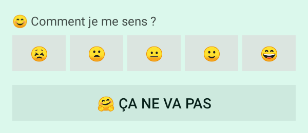

## Une nuit difficile

Dans Suivi › Sommeil, une carte douce **« 🌙 Nuit difficile ? »** (et un raccourci sur l'icône de l'appli) ouvre un
écran **sombre et chaud** (peu de lumière, pas de bleu, quel que soit le thème) : « Respire. Tu n'as rien à
réussir. » Deux gros choix, **je n'arrive pas à m'endormir** ou **je me suis réveillé·e et je n'arrive pas à me
rendormir**, puis **quatre idées courtes** : respirer lentement, une **relaxation guidée** du front aux pieds (une
phrase à la fois), vider sa tête, doux et frais (lumière douce, chaussettes chaudes) ; ou, pour se rendormir : un
réveil est normal, ne pas regarder l'heure, respirer, se détendre. Toujours : **la règle des 20 minutes** (se lever si
on est toujours éveillé·e, lumière douce, activité calme, revenir quand le sommeil revient), **« Ma recette pour me
rendormir »** (ce qui t'a aidé, noté dans tes mots, rappelé la fois suivante), « Noter ma nuit et mes réveils », un
lien vers « Ça ne va pas » si c'est l'angoisse, et un petit **« ✓ J'ai essayé »** qui rapporte des points.

Pour les journées : **« Pour mieux dormir les prochains soirs »** (heure de lever régulière, lumière du matin,
caféine le matin, siestes courtes, rituel du soir, le lit sert à dormir) et un **petit mot le soir** facultatif
(« Doucement vers la nuit », à l'heure choisie dans Paramètres › Sommeil, jamais pendant les heures calmes).
Rien de médicamenteux (ni somnifère, ni complément) ; une insomnie de plus de trois semaines, des ronflements forts
avec pauses de respiration ou une grande fatigue en journée renvoient au médecin. Hors ligne, sans diagnostic.

## Points pour prendre soin de soi, souhait de la semaine

Les points ne se retirent jamais. En plus des prises, de l'eau, du journal, des nuits et des petites victoires :
**première mesure du jour** +2, **premier symptôme noté du jour** +2 (quelle que soit sa force : on récompense le fait
de noter, jamais de souffrir), **rendez-vous préparé** +5 et **honoré** (« ✓ J'y suis allé·e ») +10, **traitement
racheté** quand le stock était bas +5, un **cadeau-surprise** (+25) après **sept jours de suite** où tu as fait
quelque chose pour toi, et trois nouveaux défis de la semaine (journal 5 jours, 6 nuits, 3 petites victoires).
Rien pour les prises « si besoin », le cycle ou les siestes. Le mot « malus » a disparu : une prise en retard rapporte
moins de points, sans reproche.

La boutique a un **souhait de la semaine** : une carte avec l'objet dont ton compagnon rêve (choisi selon la saison,
jamais un objet déjà possédé) et une barre de progression ; quand il est offert, il se réjouit. Nouveaux objets
cosy : bonnet de Noël, plaid cosy, tasse de tisane, lanterne.

## Un traitement à des heures différentes selon les jours

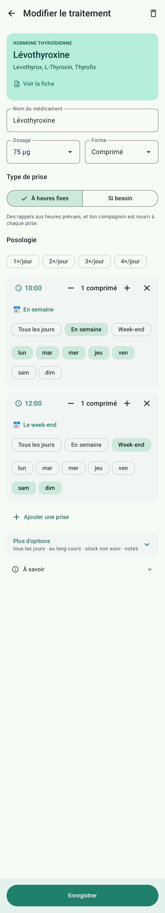

Chaque heure de prise a ses **propres jours** : par exemple Lévothyrox à **10:00 en semaine** et **12:00 le
week-end**, ou à 10:00 **tous les jours sauf le mercredi**, ou **seulement le lundi et le vendredi**. Dans le
formulaire d'un traitement, sous chaque heure, « 📅 Tous les jours » s'ouvre pour choisir : tous les jours,
en semaine, week-end, ou les jours un par un (au moins un reste toujours coché). Rien ne change tant qu'on ne
le demande pas. Les rappels et leur relance, l'accueil, la montre, le stock (la consommation de la semaine
réelle), les statistiques et le rapport pour le médecin suivent. Quand on change les jours d'une heure de
prise, le passé garde les jours qu'il avait : l'historique et les statistiques ne sont pas réécrits.

## Préparer un rendez-vous, rapport, heures calmes

- **Préparer mon rendez-vous** (depuis un rendez-vous de l'agenda) : tes questions d'abord (tu les écris à
  l'avance, elles restent avec le rendez-vous), puis un résumé des 30 derniers jours calculé sur le
  téléphone : prises et oublis, sommeil, symptômes (force, jours forts, évolution), moral et forme, cycle,
  médicaments « si besoin », mesures, et ce que l'appli remarque. À copier ou partager en texte, ou ouvrir le
  rapport PDF complet. Rien n'est envoyé tant que tu ne partages pas.
- **Rapport PDF pour le médecin** : une partie « Symptômes suivis » (jours notés, force moyenne, jours forts,
  évolution) et un cycle plus détaillé (écart entre cycles, durée des règles, flux, symptômes).
- **Journal et symptômes ensemble** : dans le journal d'un jour (n'importe lequel), la carte « Mes symptômes
  suivis » donne la force de chacun, notée tout de suite ; un symptôme coché au journal mais sans force est
  rappelé dans Suivi › Symptômes ; « Ma journée » les affiche.
- **Accueil simple / complet** (Paramètres › Mon accueil) : l'essentiel (compagnon, prochaine prise, prises du
  jour, humeur, journée douce) ou tout ; les blocs masqués ne sont pas perdus.
- **Heures calmes** (Paramètres) : l'eau, le stock, les rituels, le récap et « bien dormi ? » n'arrivent pas la
  nuit (l'eau est sautée, les autres attendent le matin). Les prises, les rendez-vous, les rappels repoussés et
  les minuteurs sonnent toujours.
- **Raccourcis** (appui long sur l'icône) : Ça ne va pas, Mon journal, et, si activés, Noter un symptôme et
  Journée douce.

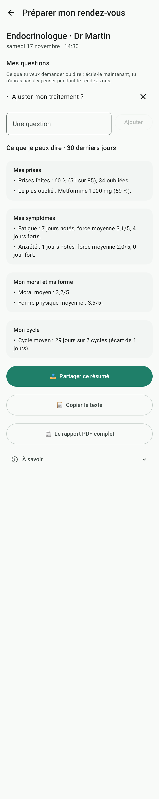

## Statistiques

Une page par sujet, pour mieux comprendre : des puces en haut (📊 Vue d'ensemble · 💊 Traitements · 🌙 Sommeil ·
🩸 Cycle si activé · 🌡️ Symptômes si activés · 😊 Bien-être) et une période commune (7, 30 ou 90 jours).

- **Vue d'ensemble** : une tuile par sujet (traitements, série, sommeil, moral, jours difficiles, petites
  victoires), « Ce qu'on remarque » (y compris les liens entre symptômes et sommeil), le rapport PDF pour le
  médecin et les points.
- **Traitements** : observance, ponctualité, évolution sur 12 semaines, calendrier, par moment, par jour, par
  traitement, et les médicaments « si besoin ».
- **Sommeil** : durée moyenne et objectif, réveils, coucher habituel, ressenti, durée nuit par nuit, siestes.
- **Cycle** : sur tes derniers cycles (pas sur un nombre de jours) : durée moyenne, durée des règles
  (d'après le flux noté), écart entre le cycle le plus court et le plus long, courbe de la durée de chaque
  cycle, flux, symptômes qui reviennent, **moral et forme selon la phase** (phases estimées par la méthode
  du calendrier), protections et médicaments. Elle remarque aussi, sur tes propres notes, un moral plus bas
  ou un symptôme suivi plus fort dans une phase (par exemple l'anxiété avant les règles), et rappelle de
  parler à un médecin quand des cycles sortent de 21 à 35 jours de façon répétée. Indicatif : ni avis
  médical ni contraception.
- **Symptômes** : pour chacun, force moyenne, jours notés, jours forts, comparaison avec la période
  précédente et courbe jour par jour (par semaine sur 90 jours).
- **Bien-être** : moral au fil du temps, eau, forme, et les petites victoires (missions et étapes faites),
  présentées sans aucun « manque ».

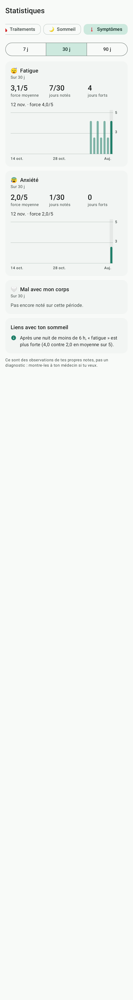

## Retrouver les choses tout de suite

**Une loupe 🔍 en haut de l'accueil et de chaque onglet**, avec **le cœur ❤️** (« Ça ne va pas ») à côté : chercher et demander
de l'aide ne demandent jamais de fouiller. On tape un mot, avec ses propres mots (« dormir », « insomnie », « règles »,
« tension », « angoisse », « ordonnance », « heures calmes », « changer de téléphone », « tuto »…), accents et majuscules
sans importance, et la recherche indique **où vit chaque chose** (« Suivi › Sommeil ») puis l'ouvre sur la bonne carte. Elle
trouve aussi tes traitements, tes rendez-vous, tes documents, les réglages, et quelques actions à faire sur place
(« un verre d'eau »). Tout se passe sur le téléphone, rien de ce qui est tapé n'est gardé ni envoyé.

La règle : **ajouter = « + Noter »**, **regarder = les onglets**, **aller mal = le cœur**. Chaque chose n'a qu'une seule place :
« Ça ne va pas » et « Respirer » ne sont plus répétés dans « + Noter » et Mieux-être (Mieux-être a « Ce que je ressens »),
et « Jour par jour » a rejoint le journal. Une carte ouverte montre où l'on est (le nom de l'onglet sous le sien).

## Un accueil et des réglages à ta mesure

- **Accueil du moment** (Paramètres › Mon accueil) : le matin (rituel, nuit, humeur, mesures), la journée (eau, mesures,
  humeur) et le soir (rituel, journal, aide au sommeil) ne mettent pas en avant les mêmes blocs. Les prises, le compagnon, la
  journée douce et tes raccourcis restent toujours devant ; le reste attend sous « Voir plus ».
- **Raccourcis** : un appui long sur une carte d'un onglet (Soins, Suivi, Mieux-être, Moi) → « Épingler sur l'accueil » ; quatre
  au plus, retirés par un appui long ou depuis « Mes cartes ».
- **Les cartes s'adaptent à l'usage** : celles que tu ouvres le plus passent devant, et après deux semaines, une carte jamais
  ouverte est proposée au rangement (« Ranger » / « Garder » : jamais sans ton accord ; elle reste trouvable avec la loupe). Le
  décompte reste sur le téléphone et se coupe dans « Mes cartes ».
- **Paramètres en groupes** qui s'ouvrent d'un toucher, un seul à la fois (Apparence, Rappels, Sommeil, Mesures, Confidentialité
  et sauvegarde, Ce qui m'accompagne, Montre, Jeu, Aide) ; la loupe ouvre directement le bon groupe.
- **Mode sobre** (Jeu et récompenses) : plus de points, de série, de badges, de boutique ni de félicitations chiffrées ; le suivi
  et les rappels sont identiques, et les points restent comptés sans bruit pour le jour où on revient.

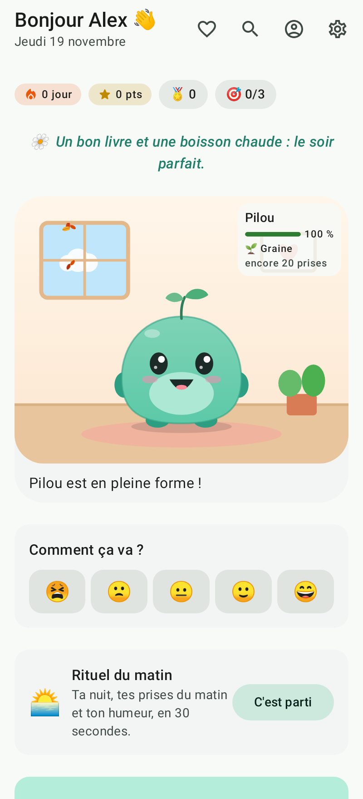 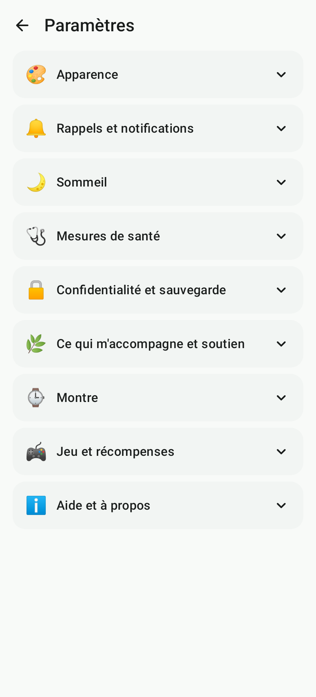

## Nuit blanche

Dans Suivi › Sommeil, **« 🌙 Nuit blanche, je n'ai pas dormi »** note la nuit en un toucher (0 h de sommeil, sans fausser tes
horaires habituels ni ton temps d'endormissement). Si le sommeil finit par venir dans la matinée, ouvre la nuit et touche
**« Finalement, je me suis endormi·e plus tard… »** : tu choisis l'heure, la nuit redevient une nuit normale.

Dans les statistiques, une nuit blanche **compte pour 0 h** dans la moyenne et n'atteint pas l'objectif ; un compteur « Nuits blanches » le dit, aussi dans le rapport pour le médecin. Elle ne fausse en revanche ni l'endormissement, ni l'efficacité, ni tes horaires habituels.

## Pause, calendrier, idées et changement de téléphone

- **Pause des rappels** (Paramètres › Rappels et notifications) : « Jusqu'à demain matin », « 3 jours » ou « 1 semaine ». Les
  rappels doux (eau, stock, rituels, récap, sommeil) se taisent ; **les prises et les rendez-vous sonnent toujours**. On peut
  ajouter les rappels de prises, mais ce n'est jamais le réglage par défaut et un avertissement le précise. Un bandeau sur
  l'accueil rappelle la pause, qui se termine toute seule (la montre suit).
- **Calendrier** (Suivi) : le mois d'un coup d'œil, avec des points pour les prises, l'humeur et les symptômes. Aucun jour n'est
  « raté » : un jour sans point est juste un jour sans note. Toucher un jour l'ouvre.
- **Une idée, un souci ?** (Paramètres › Aide, ou la loupe) : une liste qui reste sur le téléphone, avec l'écran où l'on était ;
  elle se partage en texte, rien n'est envoyé par l'appli.
- **Ordonnance renouvelée** : sur la fiche d'une ordonnance, un bouton arrête les rappels et donne +5 points, une seule fois.
- **Changer de téléphone** (Paramètres › Sauvegarde) : un guide en cinq étapes et « Tester une sauvegarde », qui ouvre le fichier
  et dit ce qu'il contient sans rien changer.

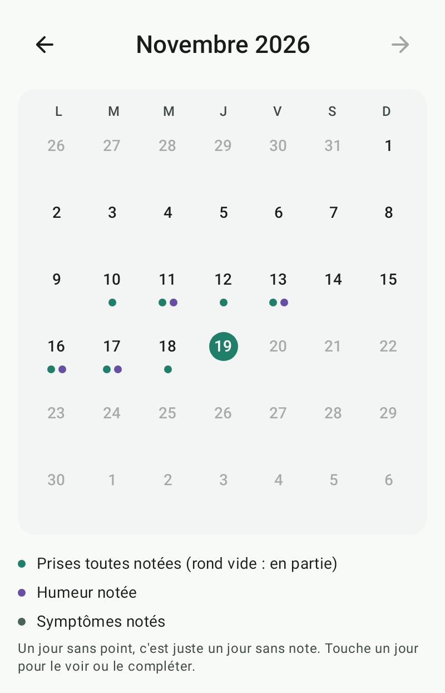 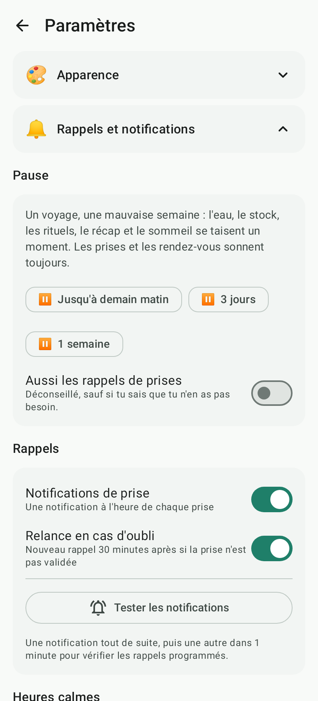

## Le petit tour de la première fois

Après la création du profil, un tour de cinq pages (une idée et quelques mots chacune), qu'on peut **passer à tout moment** et revoir depuis Paramètres › Aide
ou la recherche (« tuto ») : l'accueil et le « + », les onglets, le cœur et la loupe, puis **« Qu'est-ce qui compte pour toi ? »**
(mes traitements, mon cycle, ma santé mentale, mon sommeil). Ce choix décide quelles cartes démarrent visibles : l'essentiel
reste (traitements, agenda, journal, statistiques), le reste est rangé et revient en un toucher dans « Mes cartes ».

## Journée douce, symptômes et « ce qui m'accompagne »

Pour les jours où la maladie pèse. Tout est **facultatif et masqué tant qu'on ne l'a pas activé** :
une étape à la création du profil (« Ce qui t'accompagne », qu'on peut passer), ou plus tard dans
Mieux-être › Ce qui m'accompagne / Paramètres.

- **Ce qui m'accompagne** : on choisit ses conditions dans une liste (Hashimoto, diabète, asthme,
  endométriose, SOPK, migraine, anxiété chronique, dépression, fibromyalgie, hypertension, Crohn, arthrite,
  fatigue chronique, sclérose en plaques) ou on écrit la sienne. Une fiche courte explique, donne quelques
  repères et ce qui doit faire consulter. Choisir une condition ajoute ses symptômes habituels.
- **Symptômes** (Suivi) : un geste par jour, de 1 (un peu) à 5 (très fort), avec les sept derniers
  jours. Au-delà de 3 : « Voir ce qui peut aider » (conseils doux et **quand en parler à un médecin**,
  appelle le 15 ou le 3114 selon le cas). Des liens calculés sur place (par exemple « après une nuit de
  moins de 6 h, la fatigue est plus forte »), avec assez de jours des deux côtés, présentés comme des
  observations à montrer au médecin, jamais comme un diagnostic.
- **Journée douce** : on dit son énergie (très peu, un peu, presque comme d'habitude) et l'appli propose
  quelques toutes petites missions adaptées (se poser 5 minutes, respirer, boire, se mettre sous un
  plaid…), avec les missions écrites par la personne. Se reposer compte.
- **Points** : une mission faite rapporte quelques points (5), **jamais l'inverse** : ne pas en faire ne
  retire rien, n'est affiché nulle part, et n'a aucun effet sur les séries ni les badges. Les points
  s'arrêtent après trois petites victoires par jour (les suivantes sont fêtées sans points).
- **Découper une tâche** : on écrit la tâche, on choisit son genre (ménage, papiers, appel, message,
  courses, soin, travail) et ce qui bloque, puis on garde les étapes qui aident et on ajoute les
  siennes. La première étape, la plus dure, rapporte un peu plus (10 points, puis 3). Un chrono de cinq
  minutes facultatif aide à commencer.
- Le corps : la fiche « Mal avec mon corps » ne propose ni régime ni objectif chiffré, et dit que la
  difficulté à perdre du poids avec une maladie (thyroïde, SOPK…) n'est pas un manque de volonté.

Tout est écrit une fois dans l'appli et fonctionne **hors ligne** : rien ne part sur internet.
Ces repères généraux de bien-être sont à faire relire par un·e professionnel·le de santé avant tout
usage large ; ils ne posent aucun diagnostic et ne touchent jamais à un traitement.

| Symptômes | Journée douce |
|---|---|
| 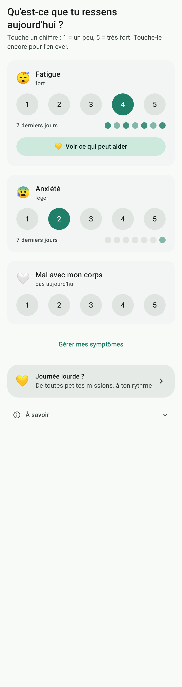 | 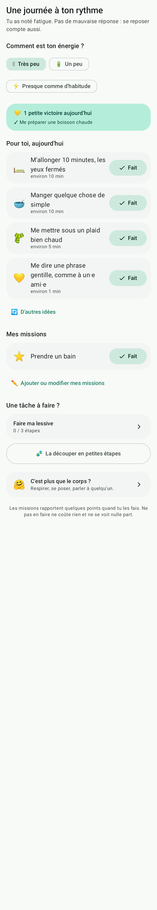 |

## Saisons et fêtes

Le compagnon vit avec l'année : **feuilles** à l'automne, **neige** l'hiver, **pétales** au
printemps, **lumière** et lucioles l'été, qui se combinent avec l'aube, le jour, le coucher de soleil
et la nuit. Une phrase du jour sur trois suit la saison, et une très légère teinte colore les fonds
de l'appli. Quelques **fêtes** (Nouvel An, Saint-Valentin, Pâques, Halloween, Noël, anniversaire du
compagnon et le tien) ont leur petit décor et un mot du compagnon, à cocher une par une. Jamais les
jours d'humeur « très mal ». Paramètres › Personnaliser › « Saisons et fêtes ».

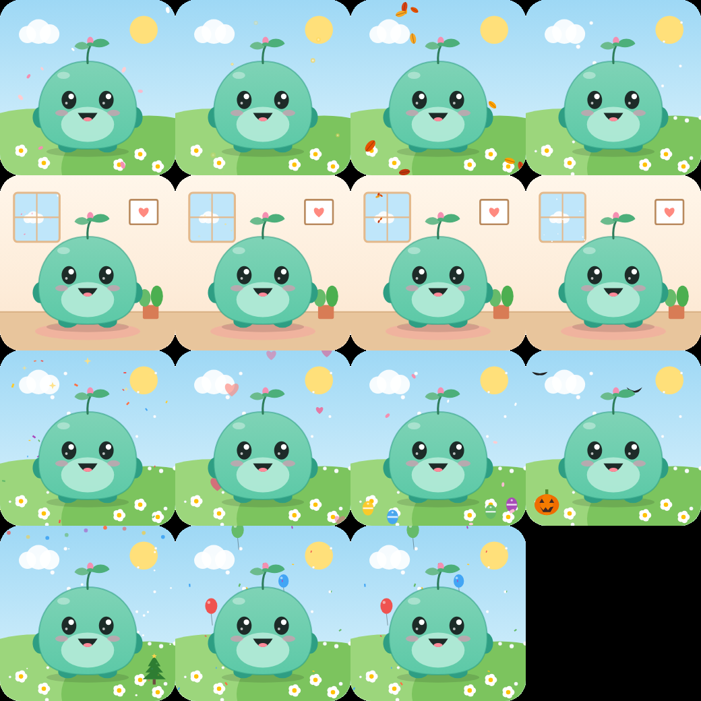

## « Ça ne va pas »

Un écran de soutien pour les moments très difficiles (tristesse, gorge nouée, angoisse) : le
**3114** en un geste (jour et nuit, gratuit), puis de quoi se calmer, **respirer** (cercle guidé,
expiration longue, vibration douce), **se poser** (5-4-3-2-1), **vider sa tête** (rien n'est gardé si
on ne le demande pas), une **boîte à réconfort**, un **plan** (signes, ce qui aide, qui appeler),
des **personnes de confiance** à appeler ou à prévenir d'un message tout prêt, et un
« me redemander dans 2 h ». La gorge nouée a sa place dans « Ce que je ressens » (moral bas), avec tous ses conseils. Accessible depuis le petit cœur de l'accueil, « + Noter » ou une
proposition douce après une humeur « très mal ». Pas de points ni de fête sur l'écran lui-même (seul « ✓ J'ai essayé » de « Ce que je ressens » en rapporte). C'est un soutien, pas un
soin : il ne remplace ni un médecin ni un psy.

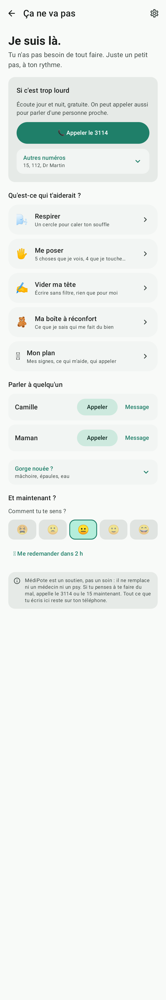

### Ce que je ressens

Dans « Ça ne va pas », en premier : on touche ce qu'on ressent, **dans le corps comme dans la tête**, et l'appli
répond. Trois familles : **anxiété** (poitrine serrée, cœur qui bat vite, souffle court, tremblements, boule au
ventre, tensions, pensées en boucle, mal à s'endormir…), **angoisse** (vague de peur, impression d'étouffer,
fourmillements, irréalité, peur de perdre le contrôle) et **moral bas** (poids dans la poitrine, fatigue
extrême, mal à se lever du lit, envie de rien faire, gorge nouée, vide, culpabilité, idées noires…).

Pour chaque chose touchée : **ce qui peut aider maintenant** (gestes simples), un mot sur **pourquoi ça arrive**,
des boutons vers les outils qui aident (respirer, me poser, vider ma tête, boîte à réconfort, journée douce) et
**quand en parler**. Une sensation dans la poitrine, le cœur ou le souffle rappelle toujours quand appeler le 15 ;
les idées noires mettent le 3114 en premier ; le moral bas et l'anxiété rappellent qu'une cause physique (thyroïde,
carence, anémie…) peut jouer et mérite un point avec le médecin. Aucun diagnostic, aucune maladie nommée, aucun
traitement touché. L'écran reste léger : trois cartes d'abord (on en ouvre une à la fois), trois idées par carte (quatre en tout) et « Plus d'idées » pour la dernière. Chaque carte a un petit **« ✓ J'ai essayé »** : essayer rapporte quelques points (les mêmes que les petites missions, trois par jour au plus, jamais retirés), ne rien essayer ne coûte rien et ne se voit nulle part ; c'est pareil pour les conseils d'un symptôme. Un bouton « Les noter dans mes symptômes » (force de 1 à 5) les ajoute au suivi, donc aux
statistiques et au rapport pour le médecin. Tout est hors ligne et à faire relire par un·e professionnel·le.

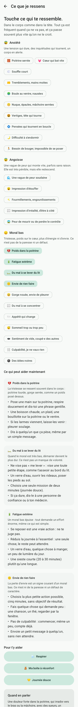

## Siestes

Dans Suivi › Sommeil : **« 😴 Je m'endors »** lance un chronomètre (visible aussi sur l'accueil,
« Je me réveille » note la sieste), ou **« Noter une sieste »** pour une sieste déjà faite
(durée, début, ressenti). Les siestes sont comptées **à part** : la moyenne, les réveils,
l'efficacité, les séries et les badges de la nuit ne bougent pas. À côté : une carte « Siestes »,
le total « nuit + siestes » par jour, et un réglage pour les compter ou non dans l'objectif.
Pas de points ni de rappels : on n'encourage pas à dormir plus.

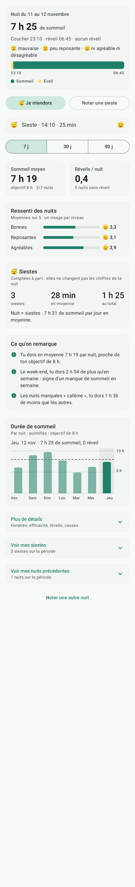

## Montre Wear OS

Une appli compagnon pour montres Wear OS 3 et plus (module `medipote-wear`), reliée
à l'appli du téléphone par la liaison montre-téléphone de Google (Bluetooth) :

- **Rappels au poignet** : la montre vibre à l'heure des prises (et 30 min après si
  ce n'est pas pris), pour l'eau et pour la protection périodique. Elle programme
  ses propres rappels à partir de l'état envoyé par le téléphone : ils sonnent
  même si le téléphone est loin.
- **Valider depuis la montre** : « Pris ✓ » ou « +10 min » dans le rappel, ou dans
  l'appli (un geste et une confirmation). Verre d'eau, médicament « si besoin » et
  « protection changée » en un geste aussi.
- **Pouls** : mesure avec le capteur de la montre, enregistrée dans Suivi › Mesures
  du téléphone (« Depuis la montre »).
- **Sieste** : « Je m'endors » / « Je me réveille » (chronomètre partagé avec le téléphone),
  ou une sieste qui vient de finir en un geste (20 min à 1 h).
- **Saturation** : saisie sur la montre (oxymètre ou appli santé de la montre), enregistrée
  dans les mesures du téléphone. La montre ne la mesure pas elle-même : le capteur n'est pas
  ouvert aux applis tierces.
- Ce qui est fait sur la montre s'affiche tout de suite et part vers le téléphone
  dès qu'il est à portée ; l'heure retenue est celle du geste sur la montre.
- Quand la montre sonne elle-même, les rappels du téléphone restent sur le
  téléphone : pas de double vibration.


Le protocole commun (module `medipote-sync`, Kotlin pur) : un « instantané » du
téléphone vers la montre, des « actions » de la montre vers le téléphone.

## Architecture

| Dossier | Contenu |
|---|---|
| `data/` | Modèles sérialisables (`Models.kt`, `Health.kt`), stockage JSON atomique (`AppRepository`), fichiers du carnet de santé (`DocumentStore`), guide des médicaments (`DrugGuide`) |
| `domain/` | Règles pures et testées : planning des prises (`Schedule`), points, série et santé du compagnon (`Game`), boutique, statistiques et analyses (`Stats`, `Reports`), prises « si besoin » (`Prn`), cycle |
| `notifications/` | `ReminderPlanner` (calcul pur et testé des alarmes : prises, relances, rendez-vous, eau, stock), `ReminderScheduler` (AlarmManager) et récepteurs |
| `widget/` | Widgets Jetpack Glance (compagnon, prises du jour, hydratation) et leurs actions |
| `ui/` | Jetpack Compose + Material 3 : un écran par dossier, `PetView` (compagnon dessiné en Canvas), navigation dans `MediPoteApp` |

Une prise prévue avant l'ajout du traitement n'est pas due : ajouter à 15 h un
médicament prévu à 8 h ne rend pas le compagnon malade.

## Notifications

Tous les rappels (prises, rendez-vous, eau, stock, sommeil) s'affichent **en
pop-up avec son et vibration** (canaux de priorité haute). Sur l'écran verrouillé,
ils ne montrent pas le nom des médicaments. Si le téléphone ou l'utilisateur a
rendu un canal discret, MédiPote le détecte et propose (accueil et paramètres)
d'ouvrir ses réglages pour réactiver « Afficher en pop-up » et le son.

Les rappels utilisent des alarmes exactes (`USE_EXACT_ALARM` sur Android 13+,
accordée automatiquement). Si un téléphone les refuse quand même, l'app se
replie sur une fenêtre de 10 minutes au plus. Dans **Paramètres → Rappels** :

- **Tester les notifications** envoie une notification tout de suite, puis une
  autre une minute plus tard par le même chemin que les vrais rappels ;
- un avertissement apparaît (ici et sur l'accueil) si les notifications sont
  bloquées, avec un raccourci vers les réglages du téléphone ;
- un raccourci vers l'**optimisation de la batterie** est proposé : sur
  certains téléphones (Xiaomi, Huawei, Samsung…), choisir « Non restreinte »
  pour MédiPote évite que les rappels soient retardés ou supprimés.

> `USE_EXACT_ALARM` est réservée sur le Play Store aux applications de type
> réveil ou calendrier. Pour une publication, il faudra peut-être la remplacer
> par `SCHEDULE_EXACT_ALARM` (que l'utilisateur accorde lui-même).

## Compiler et tester

JDK 17+ et le SDK Android (plateforme 37).

```bash
./gradlew :medipote:assembleDebug       # medipote/build/outputs/apk/debug/medipote-debug.apk
./gradlew :medipote:testDebugUnitTest   # 75 tests : règles métier, alarmes et notifications, widgets, écrans (captures dans medipote/build/screenshots) et parcours complet
./gradlew :medipote-wear:testDebugUnitTest :medipote-sync:test   # montre : écrans (medipote-wear/build/screenshots), rappels, protocole
adb install -r medipote/build/outputs/apk/debug/medipote-debug.apk
./gradlew :medipote:assembleRelease     # APK release signé (voir RELEASE.md)
```

Minimum : Android 8.0 (API 26). La version debug s'installe à côté de la release,
sous le nom « MédiPote (debug) ».

Release signée, AAB pour le Play Store, optimisations et checklist de publication :
voir [RELEASE.md](RELEASE.md). Politique de confidentialité : [PRIVACY.md](PRIVACY.md).

## Avertissement

MédiPote est un aide-mémoire : il ne remplace pas l'avis d'un médecin ou d'un
pharmacien. Les fiches du guide sont volontairement courtes et indicatives ; la
référence officielle est la
[base de données publique des médicaments](https://base-donnees-publique.medicaments.gouv.fr).
Le suivi du cycle repose sur la méthode du calendrier et n'est pas une méthode
de contraception.
