# MédiPote

Application Android (téléphone) qui aide à prendre ses traitements à l'heure. Un
petit compagnon virtuel compte sur toi : tu lui « donnes » tes médicaments à
chaque prise, il tombe malade si tu oublies, et tes points servent à
l'habiller dans la boutique.

| Accueil | Pilule | Journal | Cycle | Boutique |
|---|---|---|---|---|
| 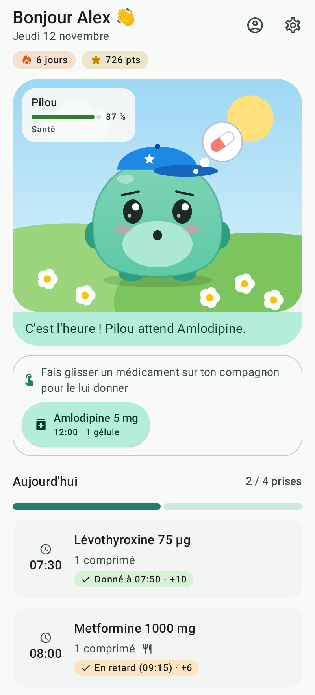 |  |  | 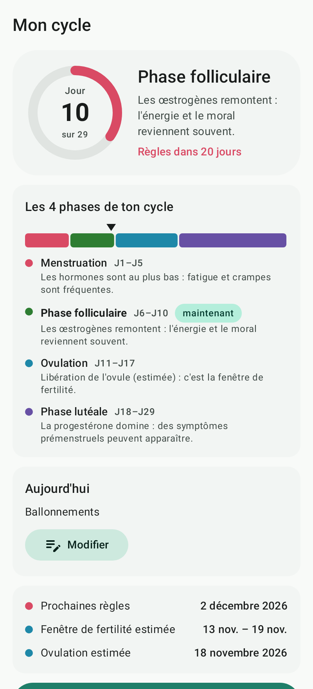 |  |

| Oubli | Agenda | Statistiques | Saisie du jour | Paramètres |
|---|---|---|---|---|
|  | 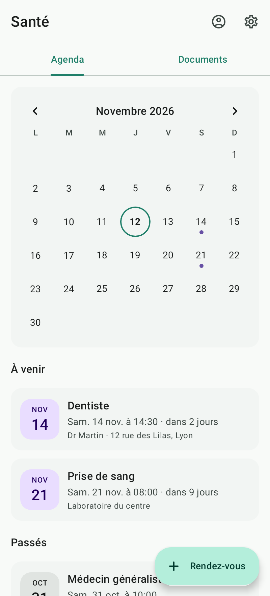 | 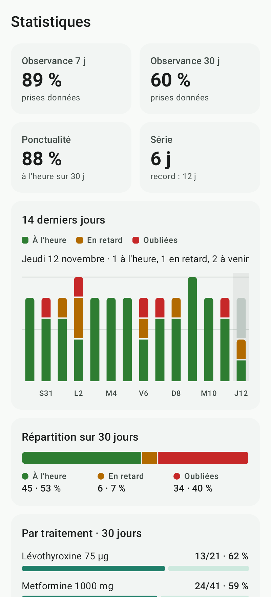 |  |  |

| Accueil | Mesures | Sauvegarde | Si besoin (accueil) | Noter une prise |
|---|---|---|---|---|
| 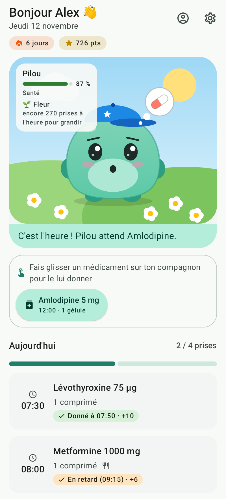 |  | 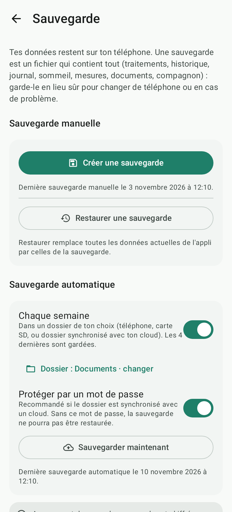 |  | 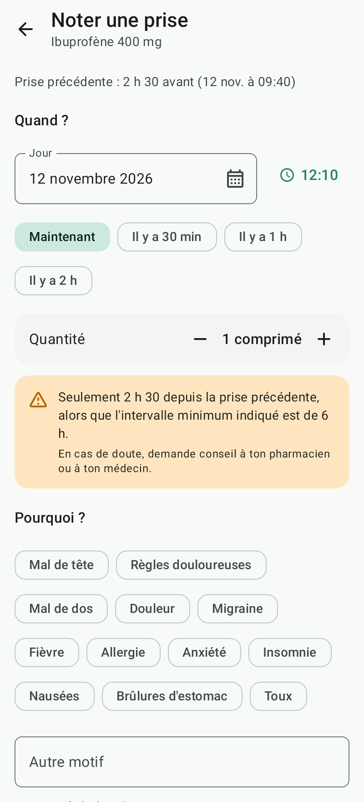 |

| Stats « si besoin » | Sommeil | Noter sa nuit | Rapport PDF |
|---|---|---|---|
|  |  | 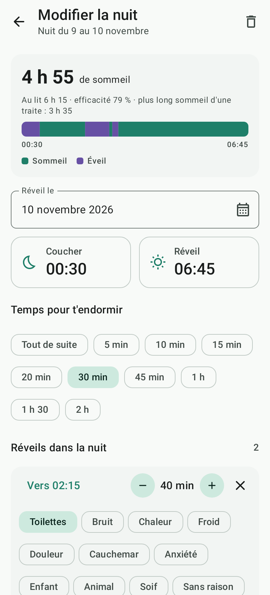 | 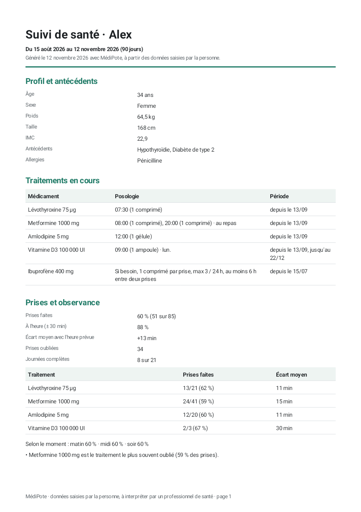 |

| Accueil personnalisé | Noir pur | Personnaliser | Série du jour | Prises oubliées |
|---|---|---|---|---|
|  | 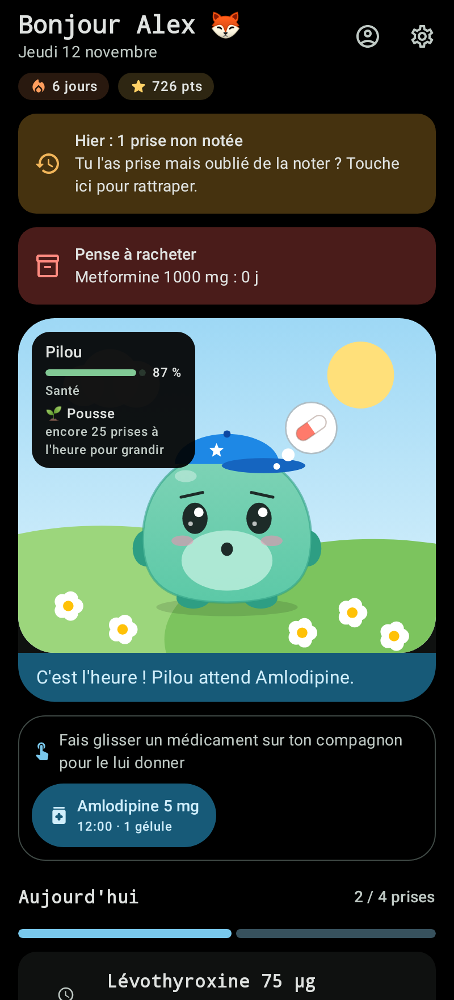 |  |  | 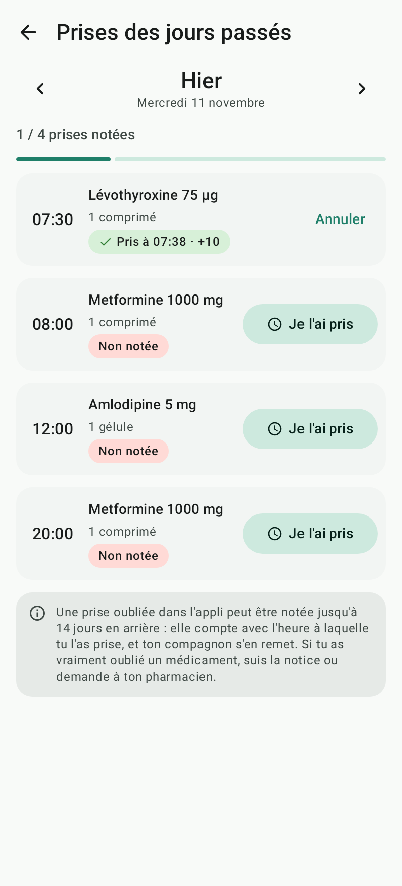 |

| Accueil 1.5 | Badges et défis | Rituel du matin | Ma journée | Année en pixels |
|---|---|---|---|---|
|  |  | 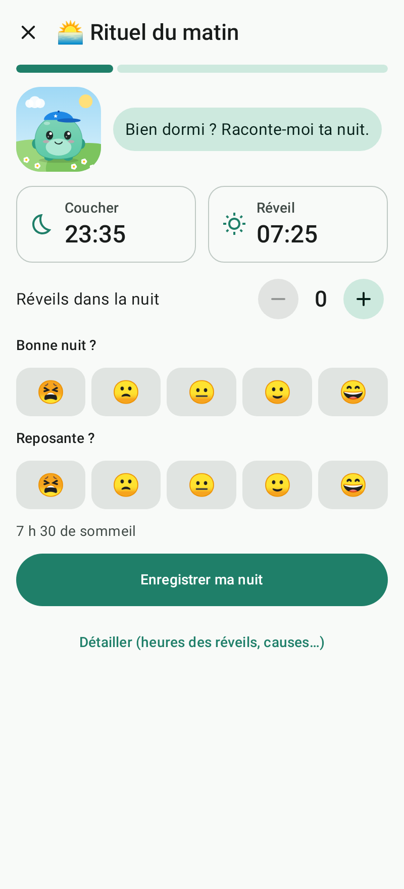 | 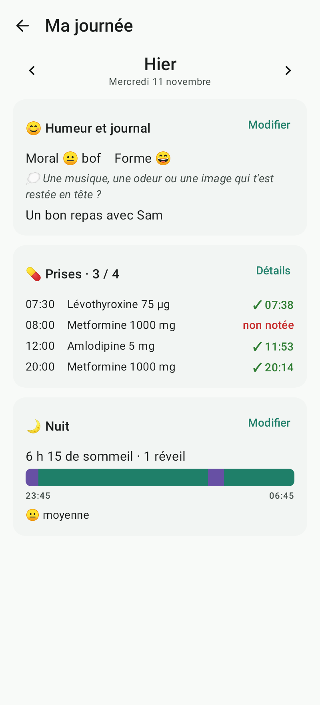 |  |

Objets exclusifs gagnés avec les badges :


Le compagnon grandit avec la régularité (graine, pousse, bouton, fleur, floraison) :

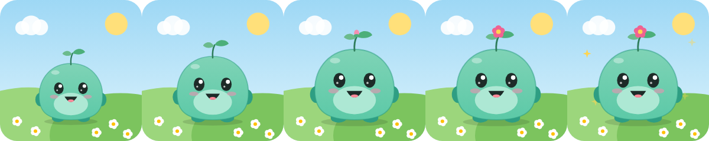

## Navigation

Cinq espaces en bas de l'écran ; dans chacun, des sous-onglets : un emoji avec
un petit mot en dessous (et le nom complet pour les lecteurs d'écran).

| Espace | Sous-onglets |
|---|---|
| **Accueil** | Prochaine prise en grand, compagnon, humeur, rituel, protection, prises du jour, si besoin, mesures, eau, rendez-vous : chaque bloc seulement quand il sert, ordre et affichage au choix (Paramètres › Mon accueil). Bouton « + Noter » pour tout noter en deux gestes. |
| **Soins** | 💊 Traitements · 🔁 Pilule (si concernée) · 📅 Agenda · 📂 Carnet (de santé) |
| **Suivi** | 📖 Journal · 🌙 Sommeil · 🩺 Mesures (si activées) · 🩸 Cycle (si activé) |
| **Bilan** | 📊 Stats · 📋 Par jour · 📆 Année |
| **Compagnon** | 🛍️ Boutique · 🏅 Badges (et défis) |

Les écrans restent aérés : cartes de traitements et jours du journal compacts
(le détail s'ouvre au toucher), sommeil avec l'essentiel d'abord (« Plus de
détails », « Voir mes nuits précédentes »), cartes protection et médicaments en
haut du cycle pendant les règles, badges gagnés d'abord et les autres repliés.

| Suivi | Bilan | Compagnon |
|---|---|---|
| 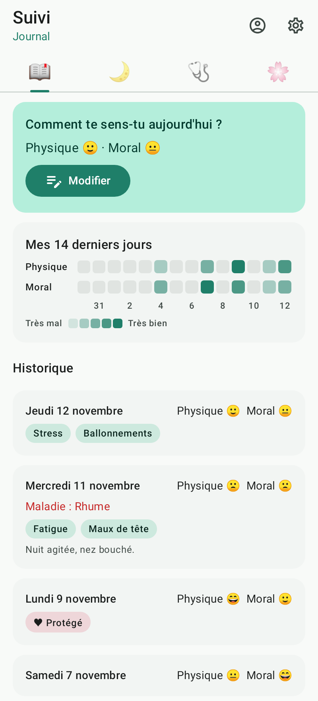 | 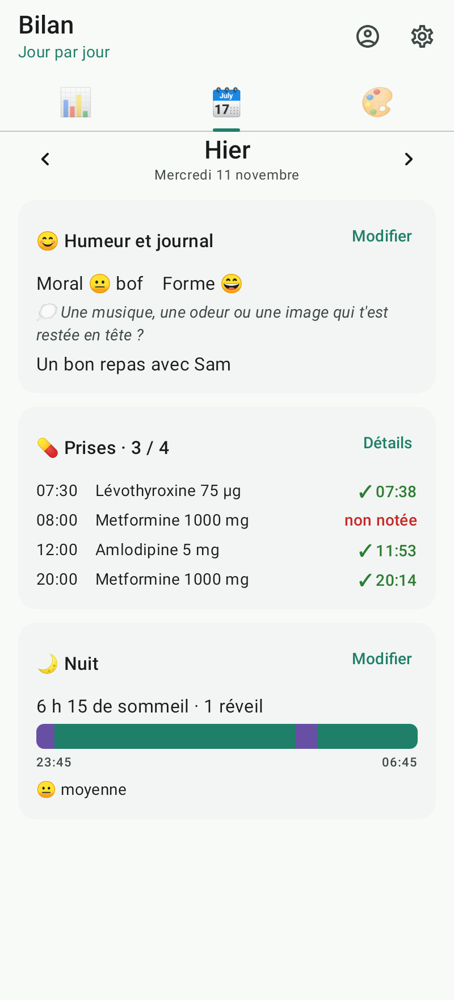 | 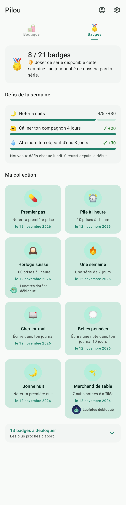 |

Profil médical et paramètres sont accessibles en haut à droite.

| Accueil 1.8 | Bouton « + Noter » |
|---|---|
|  |  |

Chaque jour, une petite phrase douce s'affiche en haut de l'accueil, et le fond du
compagnon suit l'heure (aube, jour, coucher de soleil, nuit).

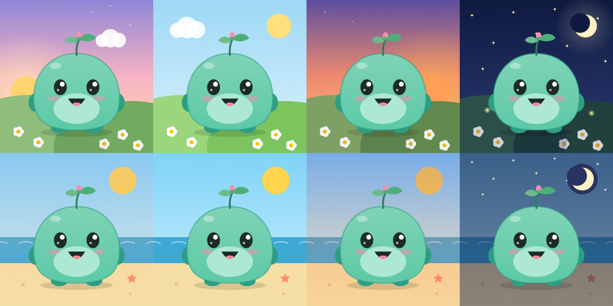

Pour garder l'appli aérée : les explications sont repliées derrière « ⓘ À savoir »
ou un petit ⓘ, et les formulaires (traitement, nuit, journal, rendez-vous, mesure)
montrent l'essentiel, le reste sous « Plus d'options ».

## Fonctionnalités

- **Profil médical** : prénom, âge, poids, taille (sans calcul d'IMC), sexe,
  antécédents et allergies (suggestions + saisie libre), suivi du cycle.
- **Guide des médicaments intégré** : environ 130 médicaments courants en France,
  recherche sans accents par nom commercial, molécule (DCI) ou classe, fiche
  courte (indication, posologie habituelle, précautions, ordonnance) et alerte
  si une allergie déclarée peut être concernée. Saisie manuelle possible.
- **Posologie** : 1 à 4 prises par jour ou horaires libres, quantité, forme,
  tous les jours, certains jours de la semaine ou **tous les N jours** ;
  au long cours, jusqu'à une date ou **pendant N jours** ; prise au repas ;
  **paliers** (dose qui change à des dates données, par exemple une
  corticothérapie dégressive : la quantité du jour est utilisée partout,
  stock compris). Changer l'heure d'une prise déjà donnée ne
  la fait pas redonner : elle suit sa nouvelle heure (aujourd'hui comme dans
  l'historique), et une heure ajoutée n'est due qu'à partir de son ajout.
- **Médicaments « si besoin »** (antidouleur, antiallergique, anxiolytique…) :
  dans l'éditeur, type de prise « Si besoin » au lieu de « À heures fixes ».
  Pas d'horaire, pas de rappel, pas de points (pour ne jamais encourager à en
  prendre plus). Chaque prise se note en deux touches depuis l'accueil ou
  l'onglet Traitements : heure (maintenant, il y a 30 min…), quantité, motif
  (mal de tête, règles douloureuses… ou texte libre), intensité de la gêne
  (0–10), contexte (travail, stress, écrans, fatigue, règles… ou texte libre),
  notes. Limites facultatives (maximum par 24 h, délai minimum entre deux
  prises) : un avertissement s'affiche si une prise les dépasse, sans bloquer.
  Une notification une heure après demande si ça a fait effet (5 niveaux).
  Le stock baisse à chaque prise, avec un seuil d'alerte en unités.
- **Stock** : quantité restante et taille de boîte par traitement. Le stock
  baisse à chaque prise ; MédiPote estime les jours restants, prévient quand
  il en reste moins que le seuil choisi (7 jours par défaut), puis rappelle
  chaque matin à 10 h jusqu'au rachat. Bouton « + boîte » sur la fiche.
- **Pilule** : choix de la pilule et du rythme (21 + 7 jours de pause, 24 + 4,
  21 + 7 placebos, 24 + 4 placebos, 28 en continu), plaquette dessinée jour par
  jour (pris, en retard, oublié, à venir, placebo, pause), dates de la semaine
  de pause et de la prochaine plaquette, rappel quotidien (aucun pendant la
  pause), réserve de plaquettes.
- **Compagnon** : il réclame son médicament, s'affaiblit en cas de retard,
  tombe malade au-delà de 2 h et dort la nuit. On le soigne en faisant glisser
  la pilule sur lui, ou avec « Donner ». Une prise déjà faite plus tôt dans la
  journée se note avec « Déjà pris ? » (après confirmation) : son rappel ne sonne pas.
- **Jouer avec le compagnon** (accueil et boutique) :
  - le toucher : il saute et dit quelque chose d'utile (prise à donner, prochaine
    prise, verre d'eau, rendez-vous proche, journal, objet à s'offrir…) ;
  - plusieurs touches rapides : fou rire ; trop de touches : il a le tournis ;
  - le caresser en glissant le doigt de côté : il ronronne, des cœurs apparaissent ;
  - appui long : gros câlin ;
  - malade, il éternue ; la nuit, on le réveille et il bâille ;
  - ses yeux suivent le doigt, il dit bonjour à l'ouverture de l'app, et le
    premier câlin du jour rapporte +3 points.

  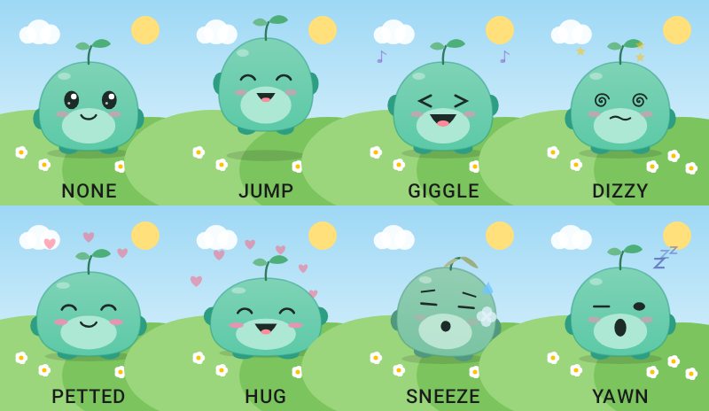

  Retour haptique à chaque réaction ; avec TalkBack, « Caresser » et « Faire un
  câlin » sont proposés comme actions.
- **Hydratation** : compteur de verres sur l'accueil (et en widget), objectif
  réglable, +2 points par verre et +10 à l'objectif, rappels toutes les 1 à 3 h
  dans une plage horaire tant que l'objectif n'est pas atteint.
- **Sommeil** (Suivi › Sommeil) : chaque matin, heure du coucher, temps
  d'endormissement, heure du réveil et **réveils dans la nuit** (heure, durée,
  cause : toilettes, bruit, chaleur, douleur, cauchemar, anxiété, enfant…),
  ressenti de la nuit en trois questions notées d'un visage (bonne ?
  reposante ? agréable ?), avec moyennes et analyses (nuits sans réveil plus
  reposantes, durée qui rend les nuits reposantes, alerte si elles le sont
  rarement), ce qui a pu jouer (écrans, caféine, alcool,
  sport, repas tardif, stress…) et notes. La saisie est pré-remplie avec tes
  horaires habituels et affiche la nuit en direct sur une frise (sommeil /
  éveil) avec durée de sommeil, temps au lit, efficacité et plus long sommeil
  d'une traite. Statistiques sur 7, 30 ou 90 jours : sommeil moyen et nuits à
  l'objectif, réveils par nuit et nuits sans réveil, heures habituelles de
  coucher et de réveil, efficacité, endormissement, qualité ; durée par nuit
  (ou par semaine sur 90 jours) avec l'objectif en pointillés, réveils par heure
  et leurs causes, historique avec frise de chaque nuit. Analyses : écart à
  l'objectif, tendance, heure des réveils, cause principale, régularité du
  coucher, efficacité, rattrapage du week-end, effet d'une habitude (« les nuits
  avec caféine, tu dors 1 h 30 de moins ») et lien avec la forme notée dans le
  journal. Objectif (8 h par défaut) et rappel du matin (désactivé par défaut)
  dans les paramètres ; +3 points pour la nuit notée le matin même (jamais liés
  à la durée ni à la qualité du sommeil).
- **Journal** : chaque jour, état physique et psychologique (5 niveaux),
  symptômes, maladie du jour, notes ; carte des 14 derniers jours.
- **Cycle** : les 4 phases (menstruation, folliculaire, ovulation, lutéale) sur
  une frise avec le jour actuel, prochaines règles, fenêtre de fertilité,
  calendrier où l'on touche un jour pour noter flux, symptômes physiques ou
  émotionnels et rapports sexuels (protégés ou non). Noter un flux démarre un
  nouveau cycle si besoin.
- **Protections périodiques** : « Je viens de mettre » une serviette, un tampon,
  une coupe, un disque ou une culotte de règles lance un minuteur ; rappel quand
  la changer (réglable), alerte à la durée maximale (avec le risque de choc
  toxique pour les protections internes), boutons « J'ai changé » / « J'ai retiré »
  dans la notification. Médicaments pendant les règles notés en deux gestes :
  antidouleurs courants proposés, ou ses propres médicaments (« Autre médicament »).
- **Agenda** : rendez-vous médicaux (motif, praticien, lieu, notes) dans un
  calendrier mensuel, avec rappels au choix (1 semaine, la veille, 2 h, 1 h,
  30 min avant).
- **Carnet de santé** : photos d'ordonnances, d'analyses ou de comptes-rendus
  prises avec l'appareil photo, ou fichiers PDF/images importés ; classement
  par catégorie, date et notes ; visionneuse avec zoom (toutes les pages d'un
  PDF) et partage.
- **Points**

  | Action | Points |
  |---|---|
  | Prise à l'heure (de 30 min avant à 30 min après) | +10 |
  | En retard (jusqu'à 2 h) | +6 (malus −4) |
  | Très en retard (au-delà de 2 h) | +3 (malus −7) |
  | Noté « Déjà pris ? » plus de 30 min avant l'horaire (le jour même) | +6 |
  | Journée parfaite (toutes les prises à l'heure) | +20 |
  | Journal du jour rempli | +5 |
  | Verre d'eau (jusqu'à l'objectif du jour) | +2 par verre |
  | Objectif d'hydratation atteint | +10 |
  | Premier câlin du jour | +3 |
  | Nuit notée le matin même | +3 |
  | Connexion quotidienne | +5 × jours de série, plafonné à +50 (dès le 10e jour) |
  | Paliers de série | 7 j : +30 · 30 j : +100 · 100 j : +300 · 365 j : +1000 |

- **Boutique** : 59 objets en 7 catégories (couleurs, chapeaux, lunettes, cou,
  objets, effets animés, décors), essayage avant achat, tous dessinés en Canvas.
- **Statistiques** (période 7, 30 ou 90 jours) : observance comparée à la
  période précédente, ponctualité, écart moyen avec l'heure prévue, série ;
  phrases d'analyse (moment ou jour le plus souvent oublié, traitement le plus
  oublié, tendance, forme les jours où tout est pris…) ; 14 derniers jours,
  évolution sur 12 semaines, calendrier de 12 semaines, répartition, observance
  par moment de la journée, par jour de la semaine et par traitement ;
  hydratation et bien-être moyens ; historique des points.
- **Statistiques « si besoin »** (30 j, 90 j, 1 an ou tout) : nombre de prises,
  jours concernés, prises par semaine, écart moyen entre deux prises,
  efficacité ressentie ; heure habituelle (moyenne circulaire : 23 h 30 et
  0 h 30 donnent minuit), histogramme par heure et par moment, par jour de la
  semaine, motifs et contextes classés, intensité moyenne, part des prises
  pendant les règles, 12 dernières semaines, historique modifiable. Une alerte
  conseille d'en parler à un professionnel au-delà de 10 jours d'usage sur 30
  ou si le maximum quotidien a été dépassé.
- **Personnalisation** (Paramètres › Personnaliser) : 18 couleurs ou **ta
  propre couleur** (teinte et intensité, nuances ajustées pour rester lisibles
  en clair comme en sombre), couleurs du fond d'écran (Android 12+), thème
  clair / sombre / système, fond teinté de ta couleur, noir pur pour les écrans
  OLED, police des titres (moderne, élégante, manuscrite, machine à écrire),
  taille du texte (85 à 130 %), coins plus ou moins arrondis, ton emoji à côté
  du « Bonjour », ta phrase du jour en haut de l'accueil, **ordre et affichage
  des blocs de l'accueil** (compagnon, prises, si besoin, mesures, eau,
  invitations, rendez-vous), animations de célébration. Aperçu en direct.
- **Rituels du matin et du soir** : un seul enchaînement de 30 secondes avec
  le compagnon. Le matin : la nuit (heures, nombre de réveils, bonne ?
  reposante ?), les prises du matin, l'humeur et la forme. Le soir : les prises
  restantes, le journal (humeur, un mot sur la journée), l'eau. +5 points par
  rituel et par jour ; carte sur l'accueil au bon moment, rappels facultatifs.
- **Humeur en un geste et phrase du jour** : 5 visages sur l'accueil, et une
  petite phrase douce ou motivante qui change chaque jour.
- **Ma journée** : tout ce qui a été noté un jour (humeur, réponse, symptômes,
  prises, si besoin, nuit, eau, cycle, mesures, rendez-vous) sur une page,
  jour après jour.
- **Mon année en pixels** : une case par jour, colorée selon l'humeur, la forme,
  le sommeil ou les prises ; touche un jour pour l'ouvrir.
- **Badges** : 21 badges (prises à l'heure, séries, journal, nuits, eau, rituels,
  défis, mesures…), dont 6 qui débloquent un objet exclusif pour le compagnon
  (couronne de fleurs, lunettes dorées, médaille étoile, trophée, lucioles,
  décor Aurore).
- **Défis de la semaine** : 3 défis doux et facultatifs chaque lundi (« Noter
  5 nuits »…), des points en plus s'ils sont réussis, rien sinon.
- **Joker de série** : un jour oublié par semaine ne casse pas la série.
- **Récap de la semaine** : le dimanche soir, quelques cartes à faire défiler
  (prises, nuits, humeur, meilleur jour, réussites) et un mot du compagnon.
- **Compagnon plus vivant** : il réagit à ta nuit (« Nuit difficile… on y va
  doucement ») et à ton journal.
- **Série quotidienne** : à la première ouverture du jour (qui commence à 4 h du
  matin, pas à minuit), une animation
  (flamme qui grandit, compteur de jours, les 7 derniers jours, confettis,
  points gagnés, prochain palier). Après une interruption : « Nouveau départ »,
  avec le rappel du record, sans culpabiliser.
- **Prises oubliées** : « Jours précédents : noter un oubli » (et un bandeau
  le lendemain s'il reste des prises non notées) ouvre l'historique jour par
  jour, jusqu'à 14 jours en arrière ; « Je l'ai pris » note la prise avec
  l'heure réelle (points selon cette heure, le compagnon s'en remet),
  « Annuler » retire une prise notée par erreur (points et stock rendus).
- **Mesures de santé** : tension (avec pouls), pouls, glycémie (à jeun, avant
  ou après un repas, au coucher), poids, température, saturation en oxygène.
  **Chaque type s'affiche ou non selon les paramètres** (aucun par défaut) :
  seuls ceux cochés apparaissent sur l'accueil, dans Suivi › Mesures et dans
  le rapport. Saisie rapide avec repères indicatifs (tension 135/85 à domicile,
  glycémie à jeun 0,70–1,10 g/L, fièvre ≥ 38 °C…), courbe avec zone de
  repères, moyenne, minimum, maximum, part dans les repères, évolution du poids,
  analyses (matin / soir pour la tension, hypoglycémies, jours de fièvre).
  Le poids est affiché sans IMC ni jugement ; le dernier poids met à jour le profil.
- **Sauvegarde et restauration** (Paramètres › Sauvegarde) : un fichier
  `.medipote` qui contient tout (données et documents), avec mot de passe
  facultatif (chiffrement AES-256-GCM, clé dérivée par PBKDF2) ; restauration
  après confirmation ; **sauvegarde automatique chaque semaine** dans un
  dossier choisi (les 4 dernières sont gardées), protégée ou non par mot de passe.
- **Boutons dans les rappels** : « Pris ✓ » donne les médicaments au
  compagnon sans ouvrir l'appli (points compris), « +10 min » et « +30 min »
  font revenir le rappel plus tard ; « J'ai bu un verre » sur le rappel d'eau.
  Ils apparaissent aussi sur une montre connectée Android.
- **Rapport pour le médecin** (Suivi › Stats) : PDF sur 1, 3, 6 ou 12 mois
  avec les parties au choix (profil, traitements, observance, « si besoin »,
  mesures avec courbes, sommeil, journal, cycle), à partager, prévisualiser ou
  enregistrer.
- **Ordonnances à renouveler** : validité de l'ordonnance (3 mois, 6 mois,
  1 an ou une date), rappel X jours avant (10 par défaut) par notification et
  sur l'accueil, état visible dans le carnet de santé.
- **Verrouillage** (Paramètres › Confidentialité) : empreinte, visage ou code du
  téléphone à l'ouverture et après 1 min en arrière-plan.
- **Compagnon qui grandit** : chaque prise à l'heure le fait grandir (graine,
  pousse, bouton, fleur, floraison) ; l'étape et les prises restantes sont
  affichées sur l'accueil.
- **Widgets d'écran d'accueil** (appui long sur l'écran d'accueil → Widgets → MédiPote) :

  | Widget | Contenu | Tailles |
  |---|---|---|
  | Mon compagnon | Le compagnon avec son humeur, sa santé, la prochaine prise et un bouton « Donner » | 2×2 à 4×3 |
  | Prises du jour | Les prises du jour avec leur état, et « Donner » pour celles à prendre | 3×2 et plus |
  | Hydratation | Verres du jour, progression, boutons « +1 verre » et « − » | 2×2 et plus |
  | Sommeil | Dernière nuit (durée, réveils), moyenne sur 7 jours, « Noter ma nuit » | 2×2 et plus |

  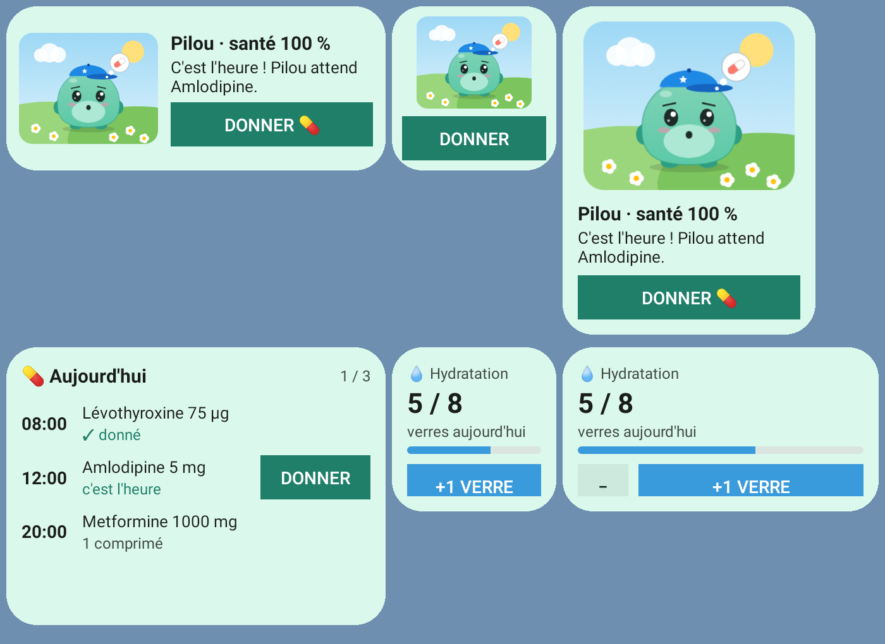

Les données (y compris de santé et les documents) restent sur le téléphone, dans
le stockage privé de l'app, exclu de la sauvegarde cloud. Elles n'en sortent que
par une action de la personne : sauvegarde, rapport PDF ou document partagé.

## Siestes

Dans Suivi › Sommeil : **« 😴 Je m'endors »** lance un chronomètre (visible aussi sur l'accueil,
« Je me réveille » note la sieste), ou **« Noter une sieste »** pour une sieste déjà faite
(durée, début, ressenti). Les siestes sont comptées **à part** : la moyenne, les réveils,
l'efficacité, les séries et les badges de la nuit ne bougent pas. À côté : une carte « Siestes »,
le total « nuit + siestes » par jour, et un réglage pour les compter ou non dans l'objectif.
Pas de points ni de rappels : on n'encourage pas à dormir plus.


## Montre Wear OS

Une appli compagnon pour montres Wear OS 3 et plus (module `medipote-wear`), reliée
à l'appli du téléphone par la liaison montre-téléphone de Google (Bluetooth) :

- **Rappels au poignet** : la montre vibre à l'heure des prises (et 30 min après si
  ce n'est pas pris), pour l'eau et pour la protection périodique. Elle programme
  ses propres rappels à partir de l'état envoyé par le téléphone : ils sonnent
  même si le téléphone est loin.
- **Valider depuis la montre** : « Pris ✓ » ou « +10 min » dans le rappel, ou dans
  l'appli (un geste et une confirmation). Verre d'eau, médicament « si besoin » et
  « protection changée » en un geste aussi.
- **Pouls** : mesure avec le capteur de la montre, enregistrée dans Suivi › Mesures
  du téléphone (« Depuis la montre »).
- **Sieste** : « Je m'endors » / « Je me réveille » (chronomètre partagé avec le téléphone),
  ou une sieste qui vient de finir en un geste (20 min à 1 h).
- **Saturation** : saisie sur la montre (oxymètre ou appli santé de la montre), enregistrée
  dans les mesures du téléphone. La montre ne la mesure pas elle-même : le capteur n'est pas
  ouvert aux applis tierces.
- Ce qui est fait sur la montre s'affiche tout de suite et part vers le téléphone
  dès qu'il est à portée ; l'heure retenue est celle du geste sur la montre.
- Quand la montre sonne elle-même, les rappels du téléphone restent sur le
  téléphone : pas de double vibration.

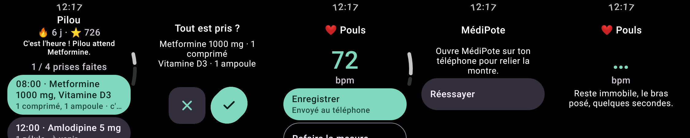

Le protocole commun (module `medipote-sync`, Kotlin pur) : un « instantané » du
téléphone vers la montre, des « actions » de la montre vers le téléphone.

## Architecture

| Dossier | Contenu |
|---|---|
| `data/` | Modèles sérialisables (`Models.kt`, `Health.kt`), stockage JSON atomique (`AppRepository`), fichiers du carnet de santé (`DocumentStore`), guide des médicaments (`DrugGuide`) |
| `domain/` | Règles pures et testées : planning des prises (`Schedule`), points, série et santé du compagnon (`Game`), boutique, statistiques et analyses (`Stats`, `Reports`), prises « si besoin » (`Prn`), cycle |
| `notifications/` | `ReminderPlanner` (calcul pur et testé des alarmes : prises, relances, rendez-vous, eau, stock), `ReminderScheduler` (AlarmManager) et récepteurs |
| `widget/` | Widgets Jetpack Glance (compagnon, prises du jour, hydratation) et leurs actions |
| `ui/` | Jetpack Compose + Material 3 : un écran par dossier, `PetView` (compagnon dessiné en Canvas), navigation dans `MediPoteApp` |

Une prise prévue avant l'ajout du traitement n'est pas due : ajouter à 15 h un
médicament prévu à 8 h ne rend pas le compagnon malade.

## Notifications

Tous les rappels (prises, rendez-vous, eau, stock, sommeil) s'affichent **en
pop-up avec son et vibration** (canaux de priorité haute). Sur l'écran verrouillé,
ils ne montrent pas le nom des médicaments. Si le téléphone ou l'utilisateur a
rendu un canal discret, MédiPote le détecte et propose (accueil et paramètres)
d'ouvrir ses réglages pour réactiver « Afficher en pop-up » et le son.

Les rappels utilisent des alarmes exactes (`USE_EXACT_ALARM` sur Android 13+,
accordée automatiquement). Si un téléphone les refuse quand même, l'app se
replie sur une fenêtre de 10 minutes au plus. Dans **Paramètres → Rappels** :

- **Tester les notifications** envoie une notification tout de suite, puis une
  autre une minute plus tard par le même chemin que les vrais rappels ;
- un avertissement apparaît (ici et sur l'accueil) si les notifications sont
  bloquées, avec un raccourci vers les réglages du téléphone ;
- un raccourci vers l'**optimisation de la batterie** est proposé : sur
  certains téléphones (Xiaomi, Huawei, Samsung…), choisir « Non restreinte »
  pour MédiPote évite que les rappels soient retardés ou supprimés.

> `USE_EXACT_ALARM` est réservée sur le Play Store aux applications de type
> réveil ou calendrier. Pour une publication, il faudra peut-être la remplacer
> par `SCHEDULE_EXACT_ALARM` (que l'utilisateur accorde lui-même).

## Compiler et tester

JDK 17+ et le SDK Android (plateforme 37).

```bash
./gradlew :medipote:assembleDebug       # medipote/build/outputs/apk/debug/medipote-debug.apk
./gradlew :medipote:testDebugUnitTest   # 75 tests : règles métier, alarmes et notifications, widgets, écrans (captures dans medipote/build/screenshots) et parcours complet
./gradlew :medipote-wear:testDebugUnitTest :medipote-sync:test   # montre : écrans (medipote-wear/build/screenshots), rappels, protocole
adb install -r medipote/build/outputs/apk/debug/medipote-debug.apk
./gradlew :medipote:assembleRelease     # APK release signé (voir RELEASE.md)
```

Minimum : Android 8.0 (API 26). La version debug s'installe à côté de la release,
sous le nom « MédiPote (debug) ».

Release signée, AAB pour le Play Store, optimisations et checklist de publication :
voir [RELEASE.md](RELEASE.md). Politique de confidentialité : [PRIVACY.md](PRIVACY.md).

## Avertissement

MédiPote est un aide-mémoire : il ne remplace pas l'avis d'un médecin ou d'un
pharmacien. Les fiches du guide sont volontairement courtes et indicatives ; la
référence officielle est la
[base de données publique des médicaments](https://base-donnees-publique.medicaments.gouv.fr).
Le suivi du cycle repose sur la méthode du calendrier et n'est pas une méthode
de contraception.
