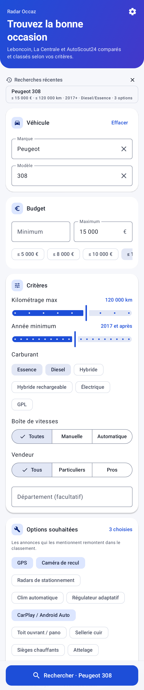
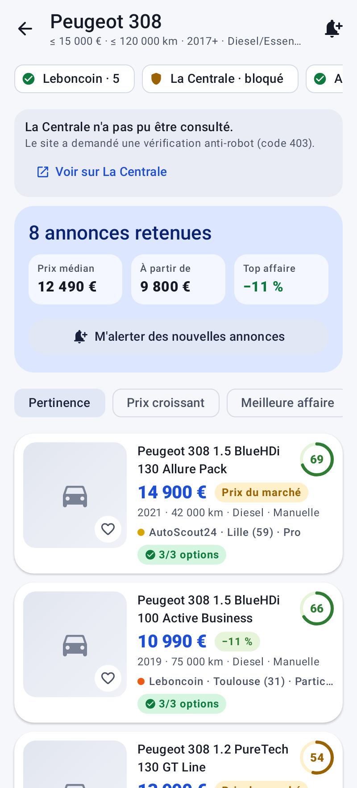
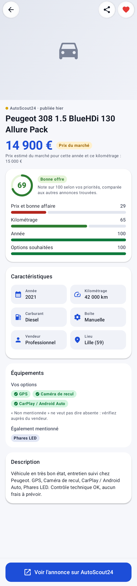
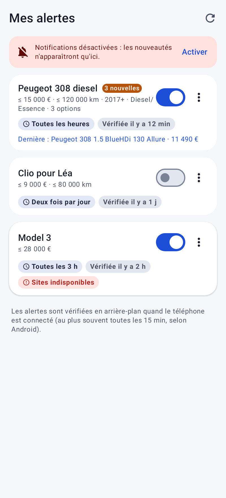
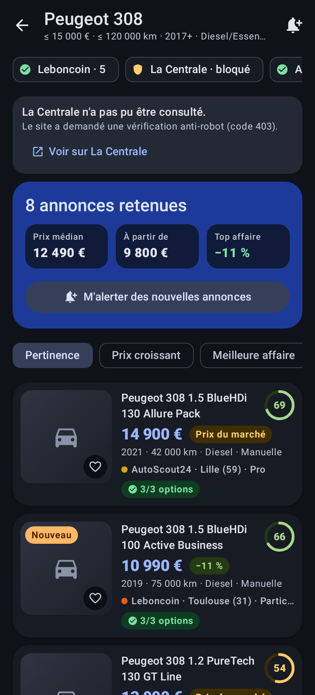

# Radar Occaz

Application Android (téléphone) qui cherche les voitures d'occasion sur
**Leboncoin**, **La Centrale** et **AutoScout24** en une seule recherche, puis
classe les annonces selon **vos** priorités. Vous pouvez aussi créer des
**alertes** pour être prévenu dès qu'une nouvelle annonce correspond.

| Recherche | Résultats | Fiche annonce | Alertes | Thème sombre |
|---|---|---|---|---|
|  |  |  |  |  |

## Fonctionnalités

- **Recherche** : marque et modèle (suggestions pour ~30 marques), budget
  min/max, kilométrage max, année minimum, carburant, boîte, particulier ou pro,
  département, et options souhaitées (GPS, caméra de recul, CarPlay, toit
  panoramique, première main, carnet d'entretien…).
- **Vos priorités** : quatre curseurs (prix, kilométrage, année, options) règlent
  le poids de chaque critère dans la note sur 100.
- **Résultats combinés** : les sites sont interrogés en parallèle. Leur état
  s'affiche en direct (nombre d'annonces, bloqué, erreur). Les annonces hors
  critères sont retirées (un accessoire à 220 €, une 3008 quand on cherche une
  308…), et une voiture publiée sur deux sites n'apparaît qu'une fois.
- **Classement** par pertinence (note), prix, meilleure affaire, kilométrage ou
  année.
- **Détection des bonnes affaires** : un modèle de prix (ln(prix) en fonction
  de l'âge et du kilométrage), ajusté sur les résultats eux-mêmes, estime le
  prix du marché de chaque voiture. Le badge affiche l'écart : « −11 % »,
  « Prix du marché » ou « +8 % ».
- **Fiche annonce** : photos, note détaillée par critère, caractéristiques,
  options trouvées ou non mentionnées, description, partage, bouton vers
  l'annonce d'origine.
- **Alertes** : depuis les résultats, la cloche enregistre la recherche. Les
  annonces déjà affichées ne sont pas signalées. Une tâche WorkManager vérifie
  les alertes en arrière-plan (de toutes les 30 min à une fois par jour, au plus
  souvent toutes les 15 min, quand le téléphone est connecté) et envoie une
  notification qui ouvre directement les résultats, avec les nouveautés
  marquées « Nouveau ».
- **Favoris**, **recherches récentes**, thème clair / sombre / système.
- **Mode démo** : des annonces fictives, générées sur le téléphone, pour
  essayer l'application sans réseau. Il est clairement signalé et proposé
  quand aucun site ne répond.

## Comment les sites sont lus

| Site | Méthode |
|---|---|
| Leboncoin | Page `/recherche` (catégorie Voitures, filtres prix/km/année/carburant/boîte/vendeur), JSON `__NEXT_DATA__` → `ads[]` |
| AutoScout24 | Page `/lst/<marque>/<modèle>`, JSON `__NEXT_DATA__` → `listings[]` |
| La Centrale | Page `/listing`, JSON d'hydratation lu par un extracteur générique, avec JSON-LD en secours |

Chaque source est une classe de `sources/` qui fournit l'URL de recherche et un
analyseur. Les tests vérifient chaque analyseur sur des pages d'exemple
(`src/test/resources/fixtures`).

### Limites à connaître

- **Protections anti-robot** : Leboncoin et La Centrale protègent leurs pages
  (DataDome). Une requête depuis un téléphone peut recevoir un captcha au lieu
  des résultats. L'application ne contourne pas ces protections. Elle affiche
  « bloqué » et propose d'ouvrir la même recherche sur le site. Les autres
  sources restent utilisées.
- **Structure des pages** : les sites changent leur code sans prévenir. Une
  source peut alors renvoyer « page illisible » jusqu'à une mise à jour de son
  analyseur. Les analyseurs ont été écrits d'après la structure connue des
  pages : ils n'ont pas pu être testés contre les sites réels depuis
  l'environnement de développement (accès bloqué).
- **Conditions d'utilisation** : les CGU de ces sites encadrent ou interdisent
  la collecte automatisée. L'application ne lit que les pages de résultats
  publiques, à la demande de l'utilisateur ou pour ses alertes, sans stocker ni
  republier les annonces. Elle est pensée pour un usage personnel. Pour une
  diffusion publique, passez par des accès officiels (API partenaires, flux)
  plutôt que par la lecture des pages.
- **Options** : elles sont trouvées par mots-clés dans le titre et la
  description. « Non mentionnée » ne veut pas dire absente.

## Architecture

| Dossier | Contenu |
|---|---|
| `data/` | Modèles sérialisables, stockage JSON atomique (`AppRepository`), catalogue marques/modèles, détection des options, utilitaires texte |
| `sources/` | `HttpFetcher` (OkHttp, détection des pages captcha), une classe par site, `GenericExtractor` (JSON embarqué + JSON-LD), `DemoSource` |
| `domain/` | `Ranking` (filtrage, pertinence, dédoublonnage, note, tri), `MarketModel` (prix du marché), `SearchEngine` (sources en parallèle, progression en `Flow`) |
| `work/` | `AlertChecker` (logique testée), `AlertScheduler` / `AlertWorker` (WorkManager), notifications |
| `ui/` | Jetpack Compose + Material 3 : recherche, résultats, fiche, alertes, favoris, réglages, navigation dans `RadarApp` |

## Compiler et tester

JDK 17+ et le SDK Android (plateforme 37).

```bash
./gradlew :radaroccaz:assembleDebug       # radaroccaz/build/outputs/apk/debug/radaroccaz-debug.apk
./gradlew :radaroccaz:testDebugUnitTest   # analyseurs, classement, moteur, alertes, écrans (captures dans radaroccaz/build/screenshots)
adb install -r radaroccaz/build/outputs/apk/debug/radaroccaz-debug.apk
```

Minimum : Android 8.0 (API 26).
