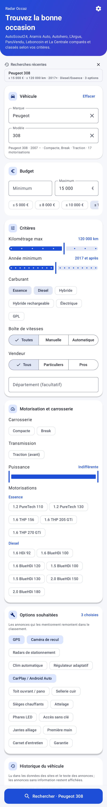
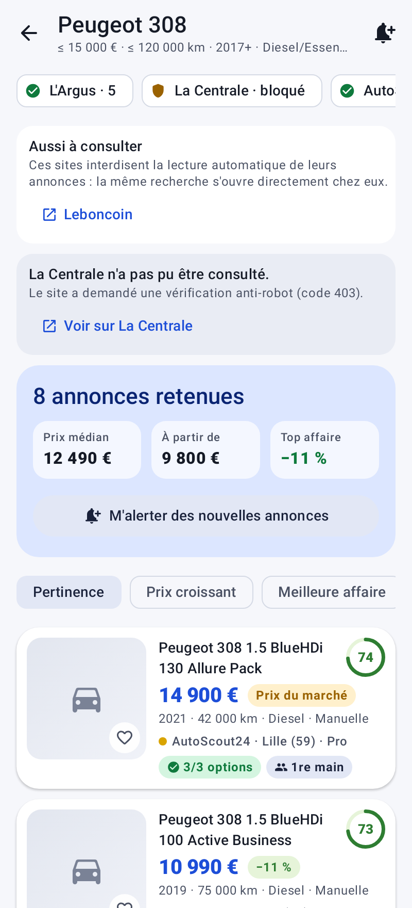
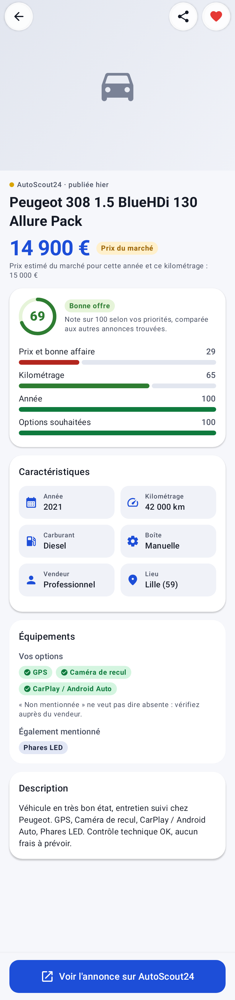
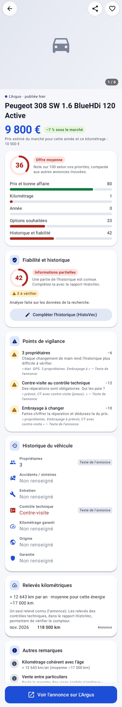
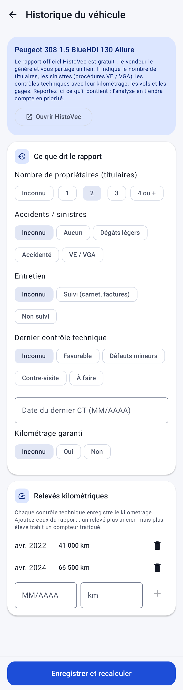
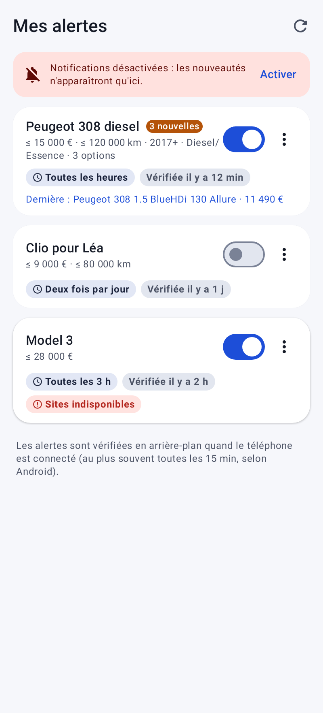

# Radar Occaz

Application Android (téléphone) qui cherche les voitures d'occasion sur
**AutoScout24**, **Aramis Auto**, **Autohero**, **L'Argus** et **ParuVendu** en
une seule recherche (avec un lien direct vers **Leboncoin** et **La Centrale**),
puis classe les annonces selon **vos** priorités. Vous pouvez aussi créer des
**alertes** pour être prévenu dès qu'une nouvelle annonce correspond.

| Recherche | Résultats | Analyse d'une annonce | Points de vigilance | Historique HistoVec | Alertes |
|---|---|---|---|---|---|
|  |  |  |  |  |  |

## Fonctionnalités

- **Catalogue** : 42 marques et 1 338 modèles (la liste d'AutoScout24), dont
  268 modèles courants avec leur fiche technique : carrosseries, transmissions
  (traction, propulsion, 4 roues motrices) et 1 709 motorisations avec énergie
  et puissance (`src/main/assets/catalog/`).
- **Recherche** : marque et modèle avec suggestions, motorisation(s) du modèle
  (regroupées par énergie), carrosserie, transmission, plage de puissance, budget
  min/max, kilométrage max, année minimum, carburant, boîte, particulier ou pro,
  département, et options souhaitées (GPS, caméra de recul, CarPlay, toit
  panoramique, première main, carnet d'entretien…).
- **Vos priorités** : cinq curseurs (prix, kilométrage, année, options,
  historique et fiabilité) règlent le poids de chaque critère dans la note sur 100.
- **Filtres d'historique** : nombre maximum de propriétaires, exclusion des
  véhicules accidentés (accident, sinistre VE/VGA, moteur HS, vendu pour pièces).
  Une annonce qui ne dit rien reste affichée.
- **Résultats combinés** : les sites sont interrogés en parallèle. Leur état
  s'affiche en direct (nombre d'annonces, bloqué, erreur). Les annonces hors
  critères sont retirées (un accessoire à 220 €, une 3008 quand on cherche une
  308…), et une voiture publiée sur deux sites n'apparaît qu'une fois.
- **Classement** par pertinence (note), prix, meilleure affaire, kilométrage ou
  année.
- **Détection des bonnes affaires** : un modèle de prix (ln(prix) en fonction
  de l'âge et du kilométrage), ajusté sur les résultats eux-mêmes, estime le
  prix du marché de chaque voiture. Le badge affiche l'écart : « −11 % »,
  « Prix du marché » ou « +8 % ».
- **Fiche annonce** : photos, note détaillée par critère, caractéristiques,
  options trouvées ou non mentionnées, description, partage, bouton vers
  l'annonce d'origine.
- **Analyse approfondie** (voir ci-dessous) : à l'ouverture d'une annonce,
  l'application lit sa page complète et produit une note de fiabilité, les
  points de vigilance et les points forts (avec la phrase de l'annonce ou le
  champ du site d'où vient chaque information), l'historique champ par champ,
  la courbe des relevés kilométriques et les questions à poser au vendeur.
- **Alertes** : depuis les résultats, la cloche enregistre la recherche. Les
  annonces déjà affichées ne sont pas signalées. Une tâche WorkManager vérifie
  les alertes en arrière-plan (de toutes les 30 min à une fois par jour, au plus
  souvent toutes les 15 min, quand le téléphone est connecté) et envoie une
  notification qui ouvre directement les résultats, avec les nouveautés
  marquées « Nouveau ».
- **Favoris**, **recherches récentes**, thème clair / sombre / système.
- **Mode démo** : des annonces fictives, générées sur le téléphone, pour
  essayer l'application sans réseau. Il est clairement signalé et proposé
  quand aucun site ne répond.

## Analyse de l'historique

L'historique est lu à trois endroits. Quand deux sources se contredisent, la
plus fiable l'emporte :

1. **Texte de l'annonce** (`analysis/HistoryText`) : expressions françaises
   courantes, accents et majuscules ignorés, avec gestion des négations
   (« jamais accidentée », « aucun frais à prévoir », « pas de contre-visite »).
   Une négation ne traverse pas un « mais ».
2. **Données des sites** (`analysis/StructuredHistory`) : champs comme le nombre
   de propriétaires précédents, l'absence d'accident ou l'historique d'entretien
   complet. Sur une page d'annonce, seul le bloc de l'annonce principale est lu,
   pas les « annonces similaires ».
3. **Saisie de l'utilisateur** : le rapport officiel **HistoVec** est gratuit
   mais n'est accessible qu'avec le lien que le vendeur partage. L'écran
   « Compléter l'historique » permet d'y reporter titulaires, sinistres, CT et
   relevés kilométriques. Si l'annonce contient un lien HistoVec, il est proposé.

| Domaine | Ce qui est vérifié |
|---|---|
| Propriétaires | Première main, 2, 3, 4 et plus ; reventes rapprochées |
| Accidents | Aucun déclaré, dégâts légers, accidenté, sinistre grave (procédure VE/VGA, VEI, épave) |
| Entretien | Carnet, factures, entretien en concession ; distribution, embrayage, freins ou pneus refaits |
| Contrôle technique | OK, défaillances mineures, contre-visite, à faire ; CT de plus de 6 mois pour une voiture de plus de 4 ans |
| Kilométrage | Relevés datés (CT cités dans l'annonce, rapport, saisie) : un relevé ancien plus élevé que l'actuel signale un compteur modifié ; kilométrage annuel comparé à la moyenne de l'énergie ; « kilométrage non garanti », compteur changé |
| Mécanique | Moteur, boîte, embrayage, turbo, FAP, joint de culasse, voyant, fuite, rouille, « vendu en l'état », pour pièces |
| Sécurité de l'achat | Formules typiques d'arnaque (coupons PCS, mandat cash, voiture à l'étranger, transporteur, paiement d'avance), prix anormalement bas, vendeur particulier ou pro, garantie |
| Annonce | Nombre de photos, description courte, année ou kilométrage manquants |

La **note de fiabilité** part de 70 (rien de connu). Chaque constat la fait
monter ou baisser, et l'écran affiche cet effet à côté de chaque point. Le
**niveau de confiance** (peu d'informations, partielles, bien documenté) dit
combien de champs sont connus. Une annonce avec un point critique perd
15 points dans le classement général par point critique. Les questions à poser
au vendeur dépendent de ce qui manque et de la voiture : distribution au-delà
de 100 000 km, FAP pour un diesel, vidange de boîte automatique, certificat
de batterie pour une électrique, COC pour une importée.

Limites : l'analyse du texte repère les formulations courantes, pas toutes.
Une information absente n'est pas une information négative. Rien ne remplace
le rapport HistoVec et l'inspection de la voiture.

## Comment les sites sont lus

Formats relevés sur les sites réels (novembre 2026) et vérifiés par
`LiveSitesTest` : 14 modèles courants × 5 sites, aucune erreur 404.

| Site | Page lue (autorisée par son robots.txt) | Données |
|---|---|---|
| AutoScout24 | `/lst/<marque>/<modèle>?priceto=…&kmto=…&fregfrom=…&fuel=…&gear=…&body=…&drivetrain=…&powerfrom=…&custtype=…` (la forme `/lst?` sans chemin est interdite) | JSON Next.js `props.pageProps.listings[]` |
| Aramis Auto | `/voitures/<marque>/<modèle>/offres/` (les paramètres de tri et de filtre sont interdits : filtrage dans l'application) | état Nuxt « devalue » (`NuxtData`) + liste JSON-LD |
| Autohero | `/fr/auto/<marque>-<modèle>/`, sinon `/fr/search/?brand0=…&models0=<libellé>` | cache Apollo (`window.__APOLLO_STATE__`), avec propriétaires, accidents, carnet, transmission |
| L'Argus | `/auto/<marque>/<modèle>/` | cartes HTML `<article>` |
| ParuVendu | `/a/voiture-occasion/<marque>/<modèle>/` (son formulaire `/auto-moto/listefo/` est interdit) | cartes HTML `<article data-id>` |
| Leboncoin | **lien direct** : `robots.txt` interdit `/recherche` et toute méthode automatique | lecture possible seulement si vous l'activez |
| La Centrale | **lien direct** : `robots.txt` interdit `/listing*`, et le site répond par un captcha (403) | idem |
| Toutes | page de l'annonce lue à l'ouverture de la fiche : description complète, attributs, lien HistoVec | |

**Pas de 404 « bêtes »** : chaque site écrit les noms à sa façon (`mercedes` ou
`mercedes-benz`, `serie-3` ou `serie-3-tous`, `classe-gla`, `id-3`…). Chaque
source essaie donc plusieurs adresses dans l'ordre (`SiteNames`) : le nom exact,
ses variantes, puis la marque seule. Elle passe à la suivante quand une page
n'existe pas ou ne contient aucune annonce du bon modèle, et garde l'adresse
qui a fonctionné pour le bouton « Ouvrir sur le site ». Le filtre de modèle
connaît aussi les désignations Mercedes (« A 180 » pour la Classe A) et BMW
(« 320d » pour la Série 3). Les loyers de LOA/LLD et les prix « sur demande »
à 1 € sont écartés.

**Écartés** : Spoticar et Le Parking refusent tout accès automatisé (403).

Chaque source est une classe de `sources/`. Les tests vérifient chaque
analyseur sur des pages enregistrées depuis les vrais sites, réduites et
débarrassées des données personnelles des vendeurs
(`src/test/resources/fixtures/*_real_search.html`).

### Limites à connaître

- **Leboncoin et La Centrale** : leurs règles interdisent la lecture
  automatique, donc l'application ouvre la recherche (déjà filtrée) chez eux.
  Le bouton « Afficher leurs annonces ici » des résultats (ou les réglages)
  active leur lecture, comme en v1, pour un usage strictement personnel et à vos risques : ils protègent leurs pages (DataDome) et
  l'application ne contourne pas ces protections.
- **Structure des pages** : les sites changent leur code sans prévenir. Une
  source peut alors renvoyer « page illisible » jusqu'à une mise à jour de son
  analyseur. `LiveSitesTest` permet de le vérifier en une commande (voir plus bas).
- **Volume et filtres côté site** : chaque site est lu sur plusieurs pages
  (jusqu'à 8 chez AutoScout24, 7 chez L'Argus, 6 chez ParuVendu, 4 chez Aramis Auto),
  avec une pause entre deux pages, et la lecture s'arrête à 150 annonces
  correspondant aux critères. AutoScout24, L'Argus (prix en centimes,
  kilométrage, année, une énergie) et Autohero (prix, kilométrage, année)
  filtrent eux-mêmes. Aramis Auto et ParuVendu interdisent ces paramètres dans
  leur robots.txt : leurs pages sont filtrées par l'application. Mesuré en
  novembre 2026 : 350 à 400 annonces retenues pour une Peugeot 308, une Clio ou
  une Golf avec budget (`LiveBudgetTest`), en une dizaine de secondes.
- **Motorisations** : elles sont reconnues dans le titre (famille, puissance,
  cylindrée), sinon par la puissance. Une annonce sans indication reste
  affichée.
- **Options** : elles sont trouvées par mots-clés dans le titre et la
  description. « Non mentionnée » ne veut pas dire absente.

## Architecture

| Dossier | Contenu |
|---|---|
| `data/` | Modèles sérialisables, stockage JSON atomique (`AppRepository`), `CarCatalog` (marques, modèles, fiches techniques), `VehicleSpecs` (motorisation, carrosserie, transmission et boîte reconnues dans le titre), détection des options |
| `sources/` | `HttpFetcher` (OkHttp, 404 et captchas), `SiteNames` (adresses candidates), une classe par site, `NuxtData`, `GenericExtractor` (JSON embarqué + JSON-LD), `DemoSource` |
| `analysis/` | `HistoryText` (historique dans le texte), `StructuredHistory` (champs des sites), `VehicleAnalysis` (constats, note de fiabilité, relevés kilométriques, questions) |
| `domain/` | `Ranking` (filtrage, pertinence, dédoublonnage, note, tri), `MarketModel` (prix du marché), `SearchEngine` (sources en parallèle, progression en `Flow`) |
| `work/` | `AlertChecker` (logique testée), `AlertScheduler` / `AlertWorker` (WorkManager), notifications |
| `ui/` | Jetpack Compose + Material 3 : recherche, résultats, fiche, alertes, favoris, réglages, navigation dans `RadarApp` |

## Compiler et tester

JDK 17+ et le SDK Android (plateforme 37).

```bash
./gradlew :radaroccaz:assembleDebug       # radaroccaz/build/outputs/apk/debug/radaroccaz-debug.apk
./gradlew :radaroccaz:testDebugUnitTest   # analyseurs, catalogue, classement, moteur, alertes, écrans (captures dans radaroccaz/build/screenshots)
./gradlew :radaroccaz:testDebugUnitTest --tests '*LiveSitesTest*' -Dradar.live=true --rerun-tasks
                                          # interroge les vrais sites pour 14 modèles et affiche ce que chacun renvoie
                                          # (*LiveBudgetTest* : nombre d'annonces retenues pour 3 recherches avec budget)
adb install -r radaroccaz/build/outputs/apk/debug/radaroccaz-debug.apk
```

Minimum : Android 8.0 (API 26).
